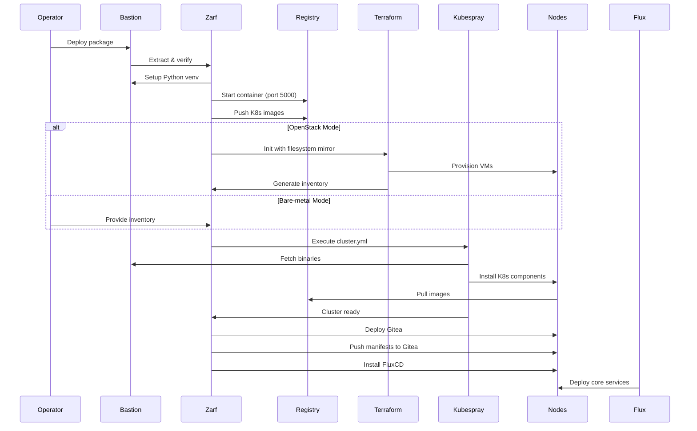

# Design Document: openCenter AirGap

## Overview

openCenter AirGap implements a "Disconnected-First" architecture for deploying High Availability Kubernetes clusters in air-gapped environments. The system inverts the traditional "pull" model (lightweight installer fetches dependencies at runtime) to a "push" model (heavyweight artifact contains every requisite component).

The architecture separates concerns into three logical zones:
- **Factory Zone (Zone A)**: Connected build environment for asset discovery and package creation
- **Airlock Zone (Zone B)**: Secure transport layer for artifact delivery
- **Field Zone (Zone C)**: Disconnected deployment environment with bastion-as-hub topology

The core innovation is treating internet isolation as the baseline constraint. A single Zarf package delivered to a bastion host contains the intelligence to provision infrastructure (optional), bootstrap Kubernetes, and deploy core services without any outbound network traffic.

**Key Design Decisions:**
- Single artifact delivery eliminates "forgotten file" errors
- Bastion-as-hub topology provides local registry and repository services
- Zarf provides industrial packaging with SBOM and cryptographic signing
- **Leverage kubespray-offline for asset collection** (images, binaries, packages)
- Zarf replaces Harbor (registry) and optionally Nginx (file serving)
- GitOps-native with FluxCD and internal Gitea for day-2 operations
- **Python 3.12+ required** for build scripts with venv at project root

## Development Environment

**Prerequisites:**
- Python 3.12 or higher (required for build scripts)
- Docker or Podman (for kubespray-offline and image handling)
- Git (for cloning kubespray-offline)
- Zarf CLI (for package creation)
- 50GB+ disk space (for asset collection)

**Setup:**
```bash
# Clone the repository
git clone <repo-url>
cd opencenter-airgap

# Create Python virtual environment at project root
python3.12 -m venv venv
source venv/bin/activate

# Install build dependencies
pip install --upgrade pip
pip install pyyaml jinja2 requests hypothesis pytest

# Verify Python version
python --version  # Should be 3.12.x or higher
```

**Python Environment Usage:**
- **Build Phase (Zone A)**: Use `PROJECT_ROOT/venv` for asset validation, manifest generation, version checking
- **Deploy Phase (Zone C)**: kubespray-offline creates `~/.venv/kubespray` on bastion for Ansible/Kubespray execution
- **Separation**: Build scripts use project venv, deployment uses bastion venv

## Architecture

### Three-Zone Model

```
┌─────────────────────────────────────────────────────────────────────────────┐
│                        ZONE A: THE FACTORY                                  │
│                    (Connected Build Environment)                            │
│                                                                             │
│  ┌──────────────────┐    ┌──────────────────┐    ┌──────────────────┐     │
│  │ kubespray-offline│───▶│ Asset Collection │───▶│ Zarf Packaging   │     │
│  │ - K8s images     │    │ - Core services  │    │ - Compress       │     │
│  │ - Binaries       │    │ - Terraform      │    │ - SBOM (Syft)    │     │
│  │ - Python wheels  │    │ - Organize       │    │ - Sign (Cosign)  │     │
│  │ - Apt packages   │    │                  │    │ - No Harbor      │     │
│  └──────────────────┘    └──────────────────┘    └──────────────────┘     │
└─────────────────────────────────────────────────────────────────────────────┘
                                    │
                                    ▼
┌─────────────────────────────────────────────────────────────────────────────┐
│                        ZONE B: THE AIRLOCK                                  │
│                        (Transport Layer)                                    │
│                                                                             │
│  ┌────────────────────────────────────────────────────────────────┐        │
│  │ openCenter-airgap-<version>.tar.zst                            │        │
│  │ - Immutable, cryptographically signed                          │        │
│  │ - Contains SBOM and checksum manifest                          │        │
│  │ - Data diode compliant                                         │        │
│  └────────────────────────────────────────────────────────────────┘        │
└─────────────────────────────────────────────────────────────────────────────┘
                                    │
                                    ▼
┌─────────────────────────────────────────────────────────────────────────────┐
│                        ZONE C: THE FIELD                                    │
│                   (Disconnected Run Environment)                            │
│                                                                             │
│  ┌──────────────────────────────────────────────────────────────┐          │
│  │                    BASTION HOST                              │          │
│  │  ┌────────────┐  ┌────────────┐  ┌────────────┐             │          │
│  │  │ Zarf CLI   │  │ Registry:2 │  │ Nginx      │             │          │
│  │  │ Orchestrate│  │ Port 5000  │  │ Port 8080  │             │          │
│  │  │            │  │ (via Zarf) │  │ (optional) │             │          │
│  │  └────────────┘  └────────────┘  └────────────┘             │          │
│  │  ┌────────────┐  ┌────────────┐                             │          │
│  │  │ Terraform  │  │ Kubespray  │                             │          │
│  │  │ (Optional) │  │ (Ansible)  │                             │          │
│  │  └────────────┘  └────────────┘                             │          │
│  └──────────────────────────────────────────────────────────────┘          │
│                           │                                                 │
│                           ▼                                                 │
│  ┌──────────────────────────────────────────────────────────────┐          │
│  │              KUBERNETES CLUSTER NODES                        │          │
│  │  ┌──────────────┐  ┌──────────────┐  ┌──────────────┐       │          │
│  │  │ Control      │  │ Control      │  │ Control      │       │          │
│  │  │ Plane 1      │  │ Plane 2      │  │ Plane 3      │       │          │
│  │  └──────────────┘  └──────────────┘  └──────────────┘       │          │
│  │  ┌──────────────┐  ┌──────────────┐  ┌──────────────┐       │          │
│  │  │ Worker 1     │  │ Worker 2     │  │ Worker N     │       │          │
│  │  └──────────────┘  └──────────────┘  └──────────────┘       │          │
│  └──────────────────────────────────────────────────────────────┘          │
└─────────────────────────────────────────────────────────────────────────────┘
```

### Deployment Flow



## Components and Interfaces

### 1. Asset Discovery System

**Purpose:** Identify and catalog all dependencies required for offline deployment.

**Inputs:**
- Kubespray version and configuration
- Kubernetes target version
- Terraform provider requirements (OpenStack mode)
- Core services versions (FluxCD, Gitea, cert-manager, etc.)

**Outputs:**
- List of container images with tags
- List of Kubernetes binaries with versions
- List of Python packages with versions
- List of system packages with versions
- List of Terraform providers with versions

**Key Algorithms:**

```python
# Pseudocode for Kubespray asset discovery
function discover_kubespray_assets(kubespray_version, k8s_version):
    context = {
        "kube_version": k8s_version,
        "image_arch": "amd64",
        "kube_image_repo": "registry.k8s.io"
    }
    
    # Load Kubespray defaults
    defaults = load_yaml("kubespray/roles/download/defaults/main.yml")
    
    images = []
    binaries = []
    
    # Render Jinja2 templates
    for key, value in defaults.items():
        if is_template(value):
            rendered = render_jinja2(value, context)
            if is_image_reference(rendered):
                images.append(rendered)
            elif is_binary_url(rendered):
                binaries.append(rendered)
    
    return images, binaries
```

**Interface:**
- `discover_assets(config) -> AssetManifest`
- `download_asset(url, checksum) -> FilePath`
- `verify_asset(filepath, checksum) -> Boolean`

## Kubespray-Offline Integration

### Overview

openCenter AirGap leverages **kubespray-offline@main** for comprehensive asset collection. kubespray-offline downloads assets from **kubespray@master** (git branch).

**Integration Philosophy**: Do NOT duplicate kubespray-offline's work. Our scope:
1. Package kubespray-offline outputs with Zarf
2. Orchestrate deployment via Zarf actions
3. Add GitOps layer (FluxCD + Gitea) post-cluster
4. Use Python 3.12+ with project-root venv for build scripts and validation

### What kubespray-offline Provides

| Asset Type | kubespray-offline Output | openCenter Usage |
|:-----------|:------------------------|:-----------------|
| **Container Images** | `outputs/images/*.tar.gz` (Docker save format) | Load into Docker, let Zarf re-package for transport |
| **K8s Binaries** | `outputs/files/` (kubeadm, kubectl, kubelet, etcd, CNI) | Copy to Zarf assets, deploy to bastion |
| **Python Wheels** | `outputs/pypi/` (Ansible, Jinja2, netaddr, etc.) | Copy to Zarf assets, install in venv |
| **Apt Packages** | `outputs/debs/local/` (full mirror) | Copy to Zarf assets, serve via Nginx |
| **Kubespray Repo** | `outputs/kubespray-*.tar.gz` (tarball from master) | Extract to Zarf assets, use for cluster bootstrap |
| **Target Scripts** | `outputs/target-scripts/` (setup-all.sh, etc.) | Package in Zarf, execute on bastion |
| **Nginx** | nginx:1.29.2 container | Zarf action runs container on port 80 |
| **Registry** | registry:2.8.3 container | Zarf manages registry:2 on port 35000 |

### Configuration

**File**: `build/kubespray-offline/target-scripts/config.sh`

```bash
#!/bin/bash
# Kubespray version to download (use "master" for latest master branch)
KUBESPRAY_VERSION=${KUBESPRAY_VERSION:-master}

# Container runtime versions (must match kubespray's roles/kubespray_defaults/vars/main/checksums.yml)
RUNC_VERSION=1.3.4
CONTAINERD_VERSION=2.1.5
NERDCTL_VERSION=2.1.6
CNI_VERSION=1.8.0

# Container versions for nginx and registry (must match imagelists/images.txt)
NGINX_VERSION=1.29.2
REGISTRY_VERSION=2.8.3

# Container registry port
REGISTRY_PORT=${REGISTRY_PORT:-35000}

# Additional container registry hosts to strip from image names
ADDITIONAL_CONTAINER_REGISTRY_LIST=${ADDITIONAL_CONTAINER_REGISTRY_LIST:-"myregistry.io"}
```

**File**: `build/kubespray-offline/imagelists/additional_images.txt`

```
# FluxCD
ghcr.io/fluxcd/source-controller:v1.4.1
ghcr.io/fluxcd/kustomize-controller:v1.4.0
ghcr.io/fluxcd/helm-controller:v1.1.0
ghcr.io/fluxcd/notification-controller:v1.4.0


# Cert-Manager
quay.io/jetstack/cert-manager-controller:v1.13.0
quay.io/jetstack/cert-manager-webhook:v1.13.0
quay.io/jetstack/cert-manager-cainjector:v1.13.0

# Ingress-NGINX
registry.k8s.io/ingress-nginx/controller:v1.9.0
registry.k8s.io/ingress-nginx/kube-webhook-certgen:v20231011-8b53cabe0

# Keycloak
quay.io/keycloak/keycloak:21.1.1

# Kube-Prometheus-Stack
quay.io/prometheus/prometheus:v2.48.0
quay.io/prometheus/alertmanager:v0.26.0
grafana/grafana:10.2.0
quay.io/prometheus-operator/prometheus-operator:v0.69.0
quay.io/kube-state-metrics/kube-state-metrics:v2.10.0
```

### Build Integration Workflow

```bash
#!/bin/bash
# scripts/build/run_kubespray_offline.sh
set -euo pipefail

PROJECT_ROOT="$(pwd)"
WORK_DIR="${PROJECT_ROOT}/build"

echo "==> Step 0: Setup Python environment"
# Create Python 3.12+ venv at project root for build scripts
if [ ! -d "${PROJECT_ROOT}/venv" ]; then
    python3.12 -m venv "${PROJECT_ROOT}/venv"
fi
source "${PROJECT_ROOT}/venv/bin/activate"
pip install --upgrade pip
pip install pyyaml jinja2 requests  # For asset validation and manifest generation

echo "==> Step 1: Configure kubespray-offline"
cd ${WORK_DIR}/kubespray-offline

# Configuration already set in target-scripts/config.sh:
# - KUBESPRAY_VERSION=master
# - Runtime versions pinned
# - additional_images.txt populated

echo "==> Step 2: Run kubespray-offline asset collection"
./download-all.sh

# Executes in sequence:
# 1. ./precheck.sh            - Verify prerequisites
# 2. ./prepare-pkgs.sh        - Install podman, python, etc.
# 3. ./prepare-py.sh          - Setup Python venv and packages
# 4. ./get-kubespray.sh       - Download/extract kubespray@master tarball
# 5. ./pypi-mirror.sh         - Create PyPI mirror for offline use
# 6. ./download-kubespray-files.sh  - Download binaries and container images
# 7. ./download-additional-containers.sh - Download nginx, registry, core services images
# 8. ./create-repo.sh         - Create DEB package repository
# 9. ./copy-target-scripts.sh - Copy scripts to outputs directory

echo "==> Step 3: Verify outputs"
ls -lh outputs/

echo "==> kubespray-offline asset collection complete!"
```

### Expected Outputs Structure

```
build/kubespray-offline/outputs/
├── files/                     # K8s binaries and components
│   ├── kubernetes/
│   │   ├── v1.xx.x/          # kubelet, kubectl, kubeadm
│   │   ├── cni/              # CNI plugins
│   │   └── cri-tools/        # crictl
│   ├── runc/                 # runc binary
│   ├── containerd-*.tar.gz   # containerd archive
│   ├── nerdctl-*.tar.gz      # nerdctl archive
│   └── helm-*.tar.gz         # helm binary
├── images/                    # Container images (tar.gz format)
│   ├── registry_2.8.3.tar.gz
│   ├── nginx_1.29.2.tar.gz
│   ├── kube-apiserver_*.tar.gz
│   ├── kube-controller-manager_*.tar.gz
│   ├── fluxcd_*.tar.gz
│   ├── gitea_*.tar.gz
│   └── ... (all K8s and add-on images)
├── debs/                      # Apt repository (Ubuntu 24.04)
│   └── local/
│       ├── Packages.gz
│       ├── Release
│       └── ... (deb packages)
├── pypi/                      # PyPI mirror
│   └── simple/
│       ├── ansible/
│       ├── jinja2/
│       └── ... (Python wheels)
├── playbook/                  # Ansible playbooks
│   └── offline-repo.yml      # Configure nodes to use local repos
├── kubespray-*.tar.gz        # Kubespray source tarball (from master)
└── target-scripts/           # Deployment scripts
    ├── setup-all.sh
    ├── setup-container.sh
    ├── start-nginx.sh
    ├── start-registry.sh
    ├── setup-offline.sh
    ├── setup-py.sh
    ├── load-push-all-images.sh
    ├── extract-kubespray.sh
    ├── offline.yml
    └── config.sh
```

### Asset Organization Script

```bash
#!/bin/bash
# scripts/build/organize_assets_for_zarf.sh
set -euo pipefail

KUBESPRAY_OFFLINE_DIR="${WORK_DIR}/kubespray-offline/outputs"
ZARF_ASSETS_DIR="${WORK_DIR}/assets"

echo "Creating Zarf asset structure..."
mkdir -p ${ZARF_ASSETS_DIR}/{k8s-binaries,python-wheels,repos/apt,target-scripts,kubespray}

# 1. Copy Kubernetes binaries
echo "Copying K8s binaries..."
cp -r ${KUBESPRAY_OFFLINE_DIR}/files/* ${ZARF_ASSETS_DIR}/k8s-binaries/

# 2. Copy Python wheels
echo "Copying Python wheels..."
cp -r ${KUBESPRAY_OFFLINE_DIR}/pypi/* ${ZARF_ASSETS_DIR}/python-wheels/

# 3. Copy apt repository
echo "Copying apt repository..."
cp -r ${KUBESPRAY_OFFLINE_DIR}/debs/* ${ZARF_ASSETS_DIR}/repos/apt/

# 4. Load container images into Docker (Zarf will re-package)
echo "Loading container images into Docker..."
for tarball in ${KUBESPRAY_OFFLINE_DIR}/images/*.tar.gz; do
    echo "  Loading $(basename ${tarball})..."
    gunzip -c ${tarball} | docker load
done

# 5. Extract Kubespray tarball
echo "Extracting Kubespray tarball..."
tar xzf ${KUBESPRAY_OFFLINE_DIR}/kubespray-*.tar.gz -C ${ZARF_ASSETS_DIR}/kubespray/

# 6. Copy target scripts
echo "Copying target scripts..."
cp -r ${KUBESPRAY_OFFLINE_DIR}/target-scripts/* ${ZARF_ASSETS_DIR}/target-scripts/

# 7. Copy playbook
echo "Copying offline-repo.yml playbook..."
cp -r ${KUBESPRAY_OFFLINE_DIR}/playbook ${ZARF_ASSETS_DIR}/

echo "Assets organized at: ${ZARF_ASSETS_DIR}"
```

### Service Endpoints

**Nginx Web Server (Port 80)**

Started by `start-nginx.sh`, serves:
- `http://localhost/files/` - Binary files
- `http://localhost/debs/` - DEB repository
- `http://localhost/pypi/` - PyPI mirror

**Private Registry (Port 35000)**

Started by `start-registry.sh`:
- Endpoint: `http://localhost:35000`
- Catalog: `http://localhost:35000/v2/_catalog`
- Data: `/var/lib/registry`

**Image Retagging**: `load-push-all-images.sh` strips registry prefixes:
- `registry.k8s.io/kube-apiserver:v1.30.0` → `localhost:35000/kube-apiserver:v1.30.0`
- Supported: registry.k8s.io, gcr.io, ghcr.io, docker.io, quay.io

### offline.yml Configuration

```yaml
# Replace YOUR_HOST with bastion IP
http_server: "http://YOUR_HOST"
registry_host: "YOUR_HOST:35000"

containerd_registries_mirrors:
  - prefix: "{{ registry_host }}"
    mirrors:
      - host: "http://{{ registry_host }}"
        capabilities: ["pull", "resolve"]
        skip_verify: true

files_repo: "{{ http_server }}/files"
ubuntu_repo: "{{ http_server }}/debs"

kube_image_repo: "{{ registry_host }}"
gcr_image_repo: "{{ registry_host }}"
docker_image_repo: "{{ registry_host }}"
quay_image_repo: "{{ registry_host }}"
github_image_repo: "{{ registry_host }}"

kubeadm_download_url: "{{ files_repo }}/kubernetes/v{{ kube_version }}/kubeadm"
kubectl_download_url: "{{ files_repo }}/kubernetes/v{{ kube_version }}/kubectl"
kubelet_download_url: "{{ files_repo }}/kubernetes/v{{ kube_version }}/kubelet"
# ... (additional binary URLs)
```

### Deployment Workflow (kubespray-offline scripts)

**Phase 1: Bastion Setup**
```bash
cd outputs/
./setup-all.sh  # Executes: setup-container.sh, start-nginx.sh, setup-offline.sh, 
                #           setup-py.sh, start-registry.sh, load-push-all-images.sh
```

**Phase 2: Kubespray Deployment**
```bash
python3.12 -m venv ~/.venv/kubespray
source ~/.venv/kubespray/bin/activate
./extract-kubespray.sh
cd kubespray-master/
pip install -r requirements.txt

cp -r inventory/sample inventory/mycluster
# Edit inventory/mycluster/hosts.yaml

cp ../offline.yml inventory/mycluster/group_vars/all/
# Edit offline.yml: replace YOUR_HOST with bastion IP

ansible-playbook -i inventory/mycluster/hosts.yaml playbook/offline-repo.yml
ansible-playbook -i inventory/mycluster/hosts.yaml --become cluster.yml
```

### What We DON'T Implement

**kubespray-offline@main already provides:**
- ✅ Asset discovery (images, binaries, packages)
- ✅ Download orchestration
- ✅ PyPI mirroring
- ✅ Apt repository creation
- ✅ Kubespray@master cloning
- ✅ Bastion setup scripts
- ✅ Registry/nginx startup
- ✅ Image loading/pushing
- ✅ offline.yml template
- ✅ offline-repo.yml playbook

**Our additions:**
- Zarf packaging (single artifact)
- SBOM generation (Syft)
- Cryptographic signing (Cosign)
- Terraform provider mirroring (OpenStack mode)
- GitOps layer (FluxCD + Gitea)
- Core services (cert-manager, ingress-nginx, Keycloak, kube-prometheus-stack)

### Differences from Original Design

| Aspect | Original Design | kubespray-offline Reality |
|:-------|:---------------|:-------------------------|
| Registry Port | 5000 | **35000** (standard) |
| Nginx Port | 8080 | **80** (standard) |
| Image Format | tar | **tar.gz** |
| Kubespray Source | git clone | **Tarball from master** |
| Python venv (bastion) | /opt/opencenter/venv | **~/.venv/kubespray** |
| Python venv (build) | N/A | **PROJECT_ROOT/venv (3.12+)** |
| Bastion Setup | Custom scripts | **Use setup-all.sh** |

### 2. Zarf Packaging System

**Purpose:** Bundle all assets into a single cryptographically verifiable artifact.

**Components:**
- `bootstrap-tools`: Terraform binary (optional), Python wheels
- `terraform-providers`: Filesystem mirror, `.terraformrc` config
- `kubespray-core`: Kubespray repo, inventory templates, K8s binaries
- `k8s-images`: All container images for K8s and add-ons
- `deploy-cluster`: Orchestration scripts

**Zarf Package Schema:**

```yaml
kind: ZarfPackageConfig
metadata:
  name: openCenter-airgap
  version: "1.0.0"
  architecture: amd64

variables:
  - name: DEPLOYMENT_MODE
    default: "baremetal"
  - name: BASTION_IP
  - name: SSH_USER
    default: "deployer"
  - name: INSTALL_PATH
    default: "/opt/opencenter"

components:
  - name: bootstrap-tools
    required: true
    files:
      - source: assets/bin/terraform
        target: /usr/local/bin/terraform
      - source: assets/python-wheels/
        target: ###ZARF_VAR_INSTALL_PATH###/wheels/
    actions:
      onDeploy:
        before:
          - cmd: "python3 -m venv ###ZARF_VAR_INSTALL_PATH###/venv"
          - cmd: "###ZARF_VAR_INSTALL_PATH###/venv/bin/pip install --no-index --find-links=###ZARF_VAR_INSTALL_PATH###/wheels/ -r requirements.txt"

  - name: terraform-providers
    required: false
    files:
      - source: assets/terraform-mirror/
        target: ###ZARF_VAR_INSTALL_PATH###/terraform-mirror/
      - source: assets/terraform-config/.terraformrc
        target: /root/.terraformrc

  - name: kubespray-core
    required: true
    files:
      - source: kubespray/
        target: ###ZARF_VAR_INSTALL_PATH###/kubespray/
      - source: assets/k8s-binaries/
        target: ###ZARF_VAR_INSTALL_PATH###/k8s-binaries/

  - name: k8s-images
    required: true
    images:
      - "registry:2"
      - "registry.k8s.io/kube-apiserver:v1.28.6"
      - "registry.k8s.io/kube-controller-manager:v1.28.6"
      # ... (full image list)
    actions:
      onDeploy:
        before:
          - cmd: "docker ps -q -f name=local-registry | grep . || docker run -d -p 5000:5000 -v /opt/registry:/var/lib/registry --name local-registry registry:2"
        after:
          - cmd: "./scripts/push-to-local-registry.sh"

  - name: deploy-cluster
    required: true
    actions:
      onDeploy:
        after:
          - cmd: "./scripts/run-deployment.sh"
```

**Interface:**
- `create_package(assets, config) -> ZarfPackage`
- `generate_sbom(package) -> SBOM`
- `sign_package(package, key) -> Signature`
- `verify_package(package, signature) -> Boolean`

### 3. Bastion Setup System

**Purpose:** Configure bastion host as local registry and repository hub.

**Services:**
- Docker Registry (port 5000): Serves container images
- Nginx (port 8080): Serves apt and PyPI repositories
- Python venv: Isolated environment for Ansible/Kubespray

**Configuration:**

```bash
# Registry startup (idempotent)
if ! docker ps -q -f name=local-registry | grep -q .; then
    docker run -d \
        -p 5000:5000 \
        -v /opt/registry:/var/lib/registry \
        --restart=always \
        --name local-registry \
        registry:2
fi

# Nginx repository server
docker run -d \
    -p 8080:80 \
    -v /opt/opencenter/repos:/usr/share/nginx/html:ro \
    --restart=always \
    --name repo-server \
    nginx:alpine
```

**Interface:**
- `setup_registry() -> RegistryEndpoint`
- `setup_repository() -> RepositoryEndpoint`
- `push_images(images, registry) -> Boolean`
- `verify_services() -> HealthStatus`

### 4. Infrastructure Provisioner (Terraform)

**Purpose:** Provision VMs and networks on OpenStack (optional component).

**Filesystem Mirror Structure:**

```
terraform-mirror/
├── registry.terraform.io/
│   ├── hashicorp/
│   │   ├── local/
│   │   │   └── 2.4.0/
│   │   │       └── linux_amd64/
│   │   │           └── terraform-provider-local_v2.4.0_x5
│   │   └── null/
│   │       └── 3.2.1/
│   └── terraform-provider-openstack/
│       └── openstack/
│           └── 1.54.0/
└── .terraform.lock.hcl
```

**Terraform Configuration:**

```hcl
# .terraformrc
plugin_cache_dir   = "/opt/opencenter/terraform-cache"
disable_checkpoint = true

provider_installation {
  filesystem_mirror {
    path    = "/opt/opencenter/terraform-mirror"
    include = ["*/*"]
  }
}
```

**Interface:**
- `init_terraform(mirror_path) -> TerraformState`
- `plan_infrastructure(config) -> Plan`
- `apply_infrastructure(plan) -> Resources`
- `generate_inventory(resources) -> AnsibleInventory`

### 5. Cluster Bootstrapper (Kubespray)

**Purpose:** Install Kubernetes using Ansible with offline configuration.

**Offline Configuration Variables:**

```yaml
# inventory/mycluster/group_vars/all/offline.yml
kube_image_repo: "{{ bastion_ip }}:5000"
gcr_image_repo: "{{ bastion_ip }}:5000"
docker_image_repo: "{{ bastion_ip }}:5000"
quay_image_repo: "{{ bastion_ip }}:5000"

download_run_once: true
download_localhost: true
local_release_dir: "/opt/opencenter/k8s-binaries"

# Containerd registry mirrors
containerd_registries_mirrors:
  - prefix: "registry.k8s.io"
    mirrors:
      - host: "http://{{ bastion_ip }}:5000"
        capabilities: ["pull", "resolve"]
  - prefix: "docker.io"
    mirrors:
      - host: "http://{{ bastion_ip }}:5000"
        capabilities: ["pull", "resolve"]
```

**Execution Flow:**

```bash
# Activate Python venv
source /opt/opencenter/venv/bin/activate

# Execute Kubespray
cd /opt/opencenter/kubespray
ansible-playbook -i inventory/mycluster/hosts.yml \
    --become \
    --become-user=root \
    cluster.yml
```

**Interface:**
- `configure_inventory(nodes, bastion_ip) -> Inventory`
- `execute_playbook(inventory) -> ClusterState`
- `verify_cluster() -> HealthStatus`
- `export_kubeconfig() -> KubeconfigPath`

### 6. Core Services Deployer

**Purpose:** Deploy GitOps infrastructure and core platform services.

**Deployment Sequence:**

1. **Gitea**: In-cluster Git server
2. **Repository Seeding**: Push manifests to Gitea
3. **FluxCD**: GitOps controllers
4. **Core Services**: cert-manager, ingress-nginx, Keycloak, kube-prometheus-stack

**GitOps Structure:**

```
gitea-repo/
├── flux-system/
│   ├── gotk-components.yaml
│   ├── gotk-sync.yaml
│   └── kustomization.yaml
├── infrastructure/
│   ├── cert-manager/
│   ├── ingress-nginx/
│   └── kustomization.yaml
├── platform/
│   ├── keycloak/
│   ├── kube-prometheus-stack/
│   └── kustomization.yaml
└── clusters/
    └── production/
        ├── infrastructure.yaml
        └── platform.yaml
```

**FluxCD Configuration:**

```yaml
# GitRepository pointing to internal Gitea
apiVersion: source.toolkit.fluxcd.io/v1
kind: GitRepository
metadata:
  name: cluster-config
  namespace: flux-system
spec:
  interval: 1m
  url: http://gitea.gitea.svc.cluster.local:3000/gitea/cluster-config
  ref:
    branch: main

---
# Kustomization for infrastructure
apiVersion: kustomize.toolkit.fluxcd.io/v1
kind: Kustomization
metadata:
  name: infrastructure
  namespace: flux-system
spec:
  interval: 10m
  sourceRef:
    kind: GitRepository
    name: cluster-config
  path: ./infrastructure
  prune: true
```

**Interface:**
- `deploy_gitea(kubeconfig) -> GiteaEndpoint`
- `seed_repository(manifests, gitea) -> RepositoryURL`
- `install_flux(kubeconfig, repo_url) -> FluxStatus`
- `verify_services(kubeconfig) -> ServiceStatus`

## Data Models

### AssetManifest

```typescript
interface AssetManifest {
  version: string;
  kubernetes_version: string;
  kubespray_version: string;
  
  images: ContainerImage[];
  binaries: Binary[];
  python_packages: PythonPackage[];
  system_packages: SystemPackage[];
  terraform_providers: TerraformProvider[];
  
  checksums: Map<string, Checksum>;
}

interface ContainerImage {
  registry: string;
  repository: string;
  tag: string;
  digest: string;
}

interface Binary {
  name: string;
  version: string;
  url: string;
  checksum: Checksum;
  architecture: string;
}

interface PythonPackage {
  name: string;
  version: string;
  platform: string;
  checksum: Checksum;
}

interface SystemPackage {
  name: string;
  version: string;
  architecture: string;
  checksum: Checksum;
}

interface TerraformProvider {
  namespace: string;
  type: string;
  version: string;
  platform: string;
  checksum: Checksum;
}

interface Checksum {
  algorithm: "md5" | "sha256" | "sha512";
  value: string;
}
```

### DeploymentConfig

```typescript
interface DeploymentConfig {
  deployment_mode: "baremetal" | "openstack";
  bastion_ip: string;
  ssh_user: string;
  install_path: string;
  
  // Bare-metal specific
  inventory?: AnsibleInventory;
  
  // OpenStack specific
  openstack_config?: OpenStackConfig;
  
  // Kubernetes configuration
  kubernetes: KubernetesConfig;
  
  // Core services
  core_services: CoreServicesConfig;
}

interface AnsibleInventory {
  control_plane: Node[];
  workers: Node[];
  etcd: Node[];
}

interface Node {
  hostname: string;
  ip: string;
  ssh_port: number;
}

interface OpenStackConfig {
  auth_url: string;
  project_name: string;
  username: string;
  password: string;  // Provided at runtime
  region: string;
  
  control_plane_count: number;
  worker_count: number;
  flavor: string;
  image: string;
  network: string;
}

interface KubernetesConfig {
  version: string;
  cluster_name: string;
  pod_network_cidr: string;
  service_network_cidr: string;
  cni: "calico" | "cilium";
}

interface CoreServicesConfig {
  gitea: {
    enabled: boolean;
    admin_password: string;  // Provided at runtime
  };
  flux: {
    enabled: boolean;
  };
  cert_manager: {
    enabled: boolean;
  };
  ingress_nginx: {
    enabled: boolean;
  };
  keycloak: {
    enabled: boolean;
    admin_password: string;  // Provided at runtime
  };
  prometheus: {
    enabled: boolean;
  };
}
```

### DeploymentState

```typescript
interface DeploymentState {
  phase: DeploymentPhase;
  components: ComponentState[];
  errors: Error[];
  start_time: Date;
  end_time?: Date;
}

enum DeploymentPhase {
  VERIFICATION = "verification",
  BASTION_SETUP = "bastion_setup",
  INFRASTRUCTURE = "infrastructure",
  CLUSTER_BOOTSTRAP = "cluster_bootstrap",
  CORE_SERVICES = "core_services",
  COMPLETE = "complete",
  FAILED = "failed"
}

interface ComponentState {
  name: string;
  status: "pending" | "in_progress" | "complete" | "failed";
  start_time?: Date;
  end_time?: Date;
  error?: string;
}
```

## Correctness Properties

*A property is a characteristic or behavior that should hold true across all valid executions of a system—essentially, a formal statement about what the system should do. Properties serve as the bridge between human-readable specifications and machine-verifiable correctness guarantees.*


### Property Reflection

After analyzing all acceptance criteria, I've identified several areas where properties can be consolidated:

**Redundancy Analysis:**

1. **Asset Discovery (1.1-1.5)**: All five criteria test the same parsing logic for different asset types. These can be combined into a single comprehensive property about parsing completeness.

2. **Checksum Validation (3.1-3.2)**: MD5 and SHA256 validation are the same operation with different algorithms. Combine into one property.

3. **Offline Operation (9.1-9.6)**: All criteria test that components don't make external connections. Combine into one comprehensive property.

4. **Version Pinning (10.1-10.7)**: All criteria test that versions are pinned. Combine into one property about version specification.

5. **Idempotency (8.1-8.3, 8.5-8.6)**: Multiple criteria test idempotency for different components. Combine into one comprehensive idempotency property, with 8.10 as the master property.

6. **Logging (11.1-11.6)**: Multiple criteria test logging for different operations. Combine into one property about logging completeness.

**Properties to Keep Separate:**

- Package creation properties (2.1-2.10) each test distinct aspects of packaging
- Integrity verification error handling (3.4-3.5) tests specific error conditions
- Infrastructure provisioning (5.1-5.8) tests distinct Terraform operations
- Cluster health verification (6.9-6.10) tests different cluster components
- Core services deployment (7.11-7.12) tests different aspects of service readiness

### Correctness Properties

#### Property 1: Asset Discovery Completeness

*For any* Kubespray configuration with pinned versions, parsing the configuration should extract all container images, binaries, Python packages, system packages, and Terraform providers referenced in the configuration, including those in Jinja2 templates after rendering.

**Validates: Requirements 1.1, 1.2, 1.3, 1.4, 1.5, 1.6**

#### Property 2: Jinja2 Template Rendering Consistency

*For any* Jinja2 template and context variables, rendering the template twice with the same context should produce identical output.

**Validates: Requirements 1.6**

#### Property 3: Terraform Lock File Cross-Platform Integrity

*For any* set of Terraform providers, generating a lock file with `-platform=linux_amd64` should produce a lock file containing SHA256 hashes for the AMD64 platform that can be verified by `terraform init` on an AMD64 system.

**Validates: Requirements 1.8**

#### Property 4: Checksum Verification Round-Trip

*For any* downloaded asset with a checksum, computing the checksum of the downloaded file should match the expected checksum value.

**Validates: Requirements 1.10, 3.1, 3.2**

#### Property 5: Package Asset Completeness

*For any* asset manifest, creating a Zarf package from the manifest and then extracting the package should yield all assets from the original manifest.

**Validates: Requirements 2.1, 2.2, 2.3**

#### Property 6: SBOM Completeness

*For any* Zarf package, the generated SBOM should contain entries for all container images, binaries, and packages included in the package.

**Validates: Requirements 2.4, 2.5, 10.9**

#### Property 7: Package Integrity Round-Trip

*For any* Zarf package, computing the MD5 and SHA256 checksums of the package file should match the checksums in the manifest, and verifying a signed package with the correct public key should succeed.

**Validates: Requirements 2.6, 2.7, 3.3**

#### Property 8: Package Format Consistency

*For any* valid asset set, creating a Zarf package should produce exactly one file with the `.tar.zst` extension and size under 10GB.

**Validates: Requirements 2.8, 2.9**

#### Property 9: Integrity Verification Error Detection

*For any* corrupted package (modified bytes), checksum validation should fail and halt deployment before extraction.

**Validates: Requirements 3.4, 3.5**

#### Property 10: Asset Extraction Completeness

*For any* Zarf package and installation path, deploying the package should extract all files to the correct locations under the installation path, organized by component.

**Validates: Requirements 4.1**

#### Property 11: Python Wheel Installation Completeness

*For any* set of Python wheels, installing them into a virtual environment should result in all packages being importable from that environment.

**Validates: Requirements 4.3**

#### Property 12: Container Image Registry Round-Trip

*For any* set of container images, loading them into a container runtime, pushing them to a local registry, and then pulling them back should yield images with identical digests.

**Validates: Requirements 4.7, 4.10**

#### Property 13: Service Health Verification

*For any* running registry and repository services, health check requests to their endpoints should return successful responses.

**Validates: Requirements 4.12**

#### Property 14: Terraform Filesystem Mirror Resolution

*For any* Terraform configuration with provider requirements, running `terraform init` with a filesystem mirror containing those providers should succeed without network access.

**Validates: Requirements 5.1**

#### Property 15: Terraform State Preservation

*For any* Terraform state file, if `terraform apply` fails, the state file should be preserved and usable for subsequent recovery operations.

**Validates: Requirements 5.8**

#### Property 16: Kubespray Offline Configuration Completeness

*For any* bastion IP address, generating a Kubespray inventory should configure all image repositories, binary paths, and package repositories to point to the bastion host.

**Validates: Requirements 6.1, 6.2, 6.3, 6.4**

#### Property 17: Cluster Health Verification

*For any* completed Kubernetes cluster deployment, querying the cluster should show all control plane components in healthy state and all worker nodes in Ready state.

**Validates: Requirements 6.9, 6.10**

#### Property 18: Core Services Readiness

*For any* deployed core service, querying the cluster should show the service's pods in Running state and its Ingress resources with valid endpoints.

**Validates: Requirements 7.11, 7.12**

#### Property 19: Deployment Idempotency

*For any* successfully deployed Zarf component, re-deploying the same component should complete without errors and without changing the cluster state (no new resources created, existing resources unchanged).

**Validates: Requirements 8.1, 8.2, 8.3, 8.4, 8.5, 8.6, 8.10**

#### Property 20: Log Preservation Across Failures

*For any* deployment operation that fails, all logs generated up to the failure point should be preserved in a persistent location on the bastion host.

**Validates: Requirements 8.7**

#### Property 21: Component Independence

*For any* Zarf component, deploying that component independently should succeed if its dependencies are already deployed, without requiring re-deployment of other components.

**Validates: Requirements 8.9**

#### Property 22: Offline Operation Compliance

*For any* deployment execution, monitoring all network connections should show zero outbound connections to external internet addresses (only connections to bastion host and cluster nodes).

**Validates: Requirements 9.1, 9.2, 9.3, 9.4, 9.5, 9.6**

#### Property 23: Network Connection Logging

*For any* deployment execution, all network connections (source, destination, port, protocol) should be logged to an audit file.

**Validates: Requirements 9.7**

#### Property 24: External Access Detection

*For any* component that attempts to connect to an external internet address, the deployment system should detect the attempt, fail the deployment, and log a clear error message identifying the component and target address.

**Validates: Requirements 9.8**

#### Property 25: Version Pinning Completeness

*For any* configuration file in the package (Kubespray, Terraform, Helm charts), parsing the file should show all version specifications are explicit (no "latest", "stable", or wildcard versions).

**Validates: Requirements 10.1, 10.2, 10.3, 10.4, 10.5, 10.6, 10.7**

#### Property 26: Deployment Determinism

*For any* Zarf package, deploying it twice to identical infrastructure should produce clusters with identical state (same versions, same configurations, same resource counts).

**Validates: Requirements 10.8**

#### Property 27: Version Resolution Strictness

*For any* dependency specification without an explicit version, the build system should fail with an error identifying the unresolved dependency.

**Validates: Requirements 10.10**

#### Property 28: Operation Logging Completeness

*For any* deployment operation (Terraform, Kubespray, Zarf action), all command output (stdout and stderr) should be captured and written to timestamped log files.

**Validates: Requirements 11.1, 11.2, 11.3, 11.4, 11.5, 11.6**

#### Property 29: Log Persistence Across Re-runs

*For any* deployment re-run, previous log files should be preserved (not overwritten) with distinct timestamps or sequence numbers.

**Validates: Requirements 11.8**

## Error Handling

### Build Phase Errors

| Error Condition | Detection | Handling |
|:---|:---|:---|
| **Missing Dependency** | Asset discovery fails to resolve a version | Fail build with error listing unresolved dependencies |
| **Download Failure** | HTTP error or timeout during asset download | Retry with exponential backoff (3 attempts), then fail build |
| **Checksum Mismatch** | Downloaded file checksum doesn't match expected | Fail build with error showing expected vs actual checksum |
| **Jinja2 Rendering Error** | Template syntax error or missing variable | Fail build with error showing template location and missing variable |
| **Terraform Lock Generation Failure** | `terraform providers lock` fails | Fail build with Terraform error output |
| **SBOM Generation Failure** | Syft fails to scan package | Fail build with Syft error output |
| **Package Size Exceeded** | Package size > 10GB | Fail build with error showing actual size and suggesting asset reduction |

### Deployment Phase Errors

| Error Condition | Detection | Handling | Recovery |
|:---|:---|:---|:---|
| **Package Corruption** | Checksum validation fails | Halt deployment, log error | Re-transfer package from source |
| **Signature Verification Failure** | Cosign verification fails | Halt deployment, log error | Verify package source, re-transfer if needed |
| **Registry Startup Failure** | Docker run fails or port conflict | Log error, check existing containers | Stop conflicting container or use different port |
| **Image Push Failure** | Registry push returns error | Log error, retry once | Check registry logs, verify disk space |
| **Terraform Init Failure** | Provider not found in mirror | Halt infrastructure phase | Verify mirror structure, rebuild package if needed |
| **Terraform Apply Failure** | Resource creation fails | Preserve state, log error | Review Terraform logs, fix configuration, re-run |
| **Kubespray Failure** | Ansible task fails | Preserve logs, halt cluster phase | Review Ansible logs, fix node issues, re-run playbook |
| **Node Unreachable** | SSH connection fails | Log error with node details | Verify network, SSH keys, firewall rules |
| **Image Pull Failure** | Node cannot pull from registry | Log error with image details | Verify registry running, check containerd config |
| **FluxCD Reconciliation Failure** | Kustomization fails | Log error, preserve Git state | Review Flux logs, fix manifests in Gitea |
| **Service Unhealthy** | Pod not reaching Running state | Log error with pod details | Check pod logs, events, resource constraints |
| **External Network Attempt** | Connection to non-local address | Halt deployment, log violation | Identify component, fix configuration, rebuild package |

### Error Recovery Patterns

**Idempotent Re-run:**
```bash
# After fixing the issue, re-run the failed component
zarf package deploy openCenter-airgap.tar.zst \
    --components=<failed-component> \
    --confirm
```

**State Preservation:**
- Terraform state: `/opt/opencenter/terraform/terraform.tfstate`
- Kubespray artifacts: `/opt/opencenter/kubespray/inventory/mycluster/artifacts/`
- Deployment logs: `/opt/opencenter/logs/<timestamp>/`
- Registry data: `/opt/registry/`

**Rollback Strategy:**
- Infrastructure: `terraform destroy` to clean up OpenStack resources
- Cluster: Kubespray reset playbook to clean nodes
- Services: `flux uninstall` to remove FluxCD and managed resources

## Testing Strategy

### Dual Testing Approach

The testing strategy employs both unit tests and property-based tests as complementary approaches:

**Unit Tests:**
- Verify specific examples and edge cases
- Test integration points between components
- Validate error conditions and error messages
- Test specific configuration scenarios (bare-metal vs OpenStack)

**Property-Based Tests:**
- Verify universal properties across all inputs
- Test with randomized configurations and data
- Ensure correctness across the input space
- Validate invariants and round-trip properties

### Kubespray-Offline Integration Benefits

By leveraging kubespray-offline, openCenter AirGap gains:

**Reduced Development Effort:**
- No need to re-implement Kubespray asset discovery logic
- Proven asset collection for multiple Kubespray versions
- Maintained compatibility with Kubespray updates

**Comprehensive Coverage:**
- All K8s images (control plane, CNI, add-ons)
- All binaries (kubeadm, kubectl, kubelet, etcd, CNI plugins)
- All Python dependencies (Ansible, Jinja2, netaddr, etc.)
- Complete apt repository mirror for Ubuntu

**Simplified Testing:**
- Test kubespray-offline integration (verify outputs exist)
- Test asset organization (verify Zarf structure)
- Test Zarf packaging (verify single artifact)
- No need to test individual asset downloads

**Maintenance:**
- kubespray-offline handles upstream changes
- openCenter focuses on Zarf packaging and deployment orchestration
- Clear separation of concerns

### Property-Based Testing Configuration

**Library Selection:**
- **Python**: Hypothesis (for build scripts and asset discovery)
- **Bash**: Bats with random input generation (for deployment scripts)
- **Go**: gopter or rapid (if any Go components are added)

**Test Configuration:**
- Minimum 100 iterations per property test
- Each test tagged with: `Feature: opencenter-airgap, Property N: <property_text>`
- Seed randomization for reproducibility
- Shrinking enabled to find minimal failing cases

### Test Coverage by Component

#### Asset Discovery System

**Unit Tests:**
- Parse known Kubespray configuration (v2.24.1, K8s v1.28.6)
- Handle missing Jinja2 variables gracefully
- Detect unsupported asset types

**Property Tests:**
- Property 1: Asset Discovery Completeness
- Property 2: Jinja2 Template Rendering Consistency
- Property 4: Checksum Verification Round-Trip

#### Zarf Packaging System

**Unit Tests:**
- Create package with minimal asset set
- Handle empty component gracefully
- Reject package exceeding size limit

**Property Tests:**
- Property 5: Package Asset Completeness
- Property 6: SBOM Completeness
- Property 7: Package Integrity Round-Trip
- Property 8: Package Format Consistency

#### Verification System

**Unit Tests:**
- Verify valid package with correct checksums
- Reject package with single bit flip
- Handle missing signature file

**Property Tests:**
- Property 9: Integrity Verification Error Detection

#### Bastion Setup System

**Unit Tests:**
- Setup registry on clean system
- Reuse existing registry (idempotency)
- Handle port conflict gracefully

**Property Tests:**
- Property 10: Asset Extraction Completeness
- Property 11: Python Wheel Installation Completeness
- Property 12: Container Image Registry Round-Trip
- Property 13: Service Health Verification

#### Infrastructure Provisioner

**Unit Tests:**
- Skip Terraform in bare-metal mode
- Generate inventory from Terraform outputs
- Preserve state on apply failure

**Property Tests:**
- Property 14: Terraform Filesystem Mirror Resolution
- Property 15: Terraform State Preservation

#### Cluster Bootstrapper

**Unit Tests:**
- Generate inventory with bastion IP
- Configure containerd mirrors correctly
- Export kubeconfig to expected location

**Property Tests:**
- Property 16: Kubespray Offline Configuration Completeness
- Property 17: Cluster Health Verification

#### Core Services Deployer

**Unit Tests:**
- Deploy Gitea with default configuration
- Create FluxCD GitRepository resource
- Verify Ingress creation

**Property Tests:**
- Property 18: Core Services Readiness

#### Deployment System (Cross-Cutting)

**Unit Tests:**
- Re-deploy component without errors
- Preserve logs on failure
- Deploy single component independently

**Property Tests:**
- Property 19: Deployment Idempotency
- Property 20: Log Preservation Across Failures
- Property 21: Component Independence
- Property 22: Offline Operation Compliance
- Property 23: Network Connection Logging
- Property 24: External Access Detection

#### Build System (Cross-Cutting)

**Unit Tests:**
- Reject configuration with "latest" tag
- Fail on unresolved dependency
- Generate SBOM with all versions

**Property Tests:**
- Property 25: Version Pinning Completeness
- Property 26: Deployment Determinism
- Property 27: Version Resolution Strictness

#### Logging System (Cross-Cutting)

**Unit Tests:**
- Write logs to correct location
- Rotate logs when size limit reached
- Preserve logs across re-runs

**Property Tests:**
- Property 28: Operation Logging Completeness
- Property 29: Log Persistence Across Re-runs

### Integration Testing

**End-to-End Scenarios:**
1. **Bare-metal Deployment**: Build package → Deploy to pre-provisioned VMs → Verify cluster → Verify services
2. **OpenStack Deployment**: Build package → Deploy with Terraform → Verify cluster → Verify services
3. **Failure Recovery**: Simulate node failure during Kubespray → Re-run → Verify recovery
4. **Idempotency**: Deploy package → Re-deploy same package → Verify no changes
5. **Offline Validation**: Deploy with network monitoring → Verify zero external connections

**Test Environment:**
- Nested virtualization for OpenStack testing
- Vagrant/Libvirt for bare-metal simulation
- Network isolation via iptables rules
- Packet capture for offline validation

### Continuous Integration

**Build Pipeline:**
1. Run unit tests for all components
2. Run property tests (100 iterations each)
3. Build Zarf package
4. Verify package integrity
5. Deploy to test environment (bare-metal)
6. Run integration tests
7. Deploy to test environment (OpenStack)
8. Run integration tests
9. Generate test report

**Test Artifacts:**
- Unit test results (JUnit XML)
- Property test results with seeds
- Integration test logs
- Package SBOM
- Deployment logs
- Network capture files

### Performance Testing

**Metrics:**
- Package build time (target: < 30 minutes)
- Package size (target: < 5GB)
- Deployment time bare-metal (target: < 30 minutes)
- Deployment time OpenStack (target: < 45 minutes)
- Registry image push time (target: < 10 minutes)

**Load Testing:**
- Deploy to clusters of varying sizes (3-10 nodes)
- Measure resource usage on bastion host
- Verify registry performance under concurrent pulls
