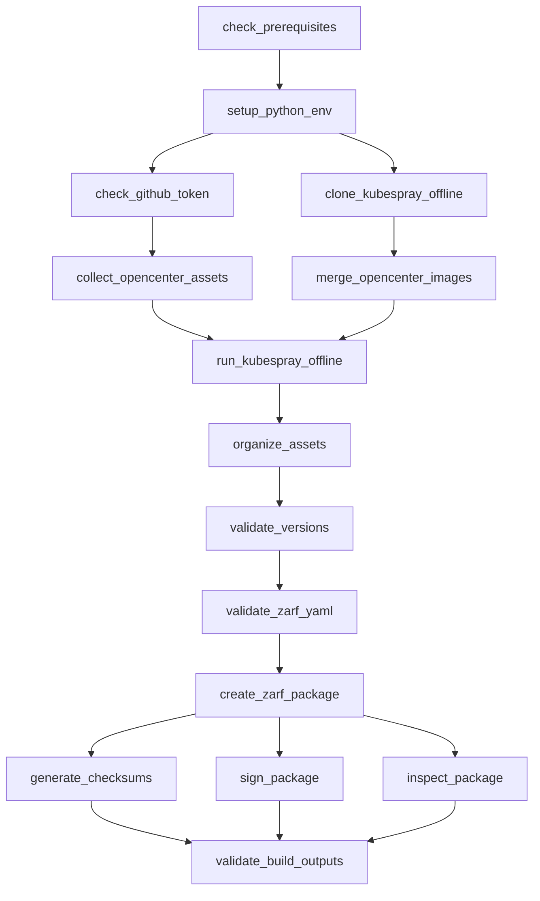

# Design Document: Resumable Build System

## Overview

The resumable build system transforms the monolithic Bash-based build orchestrator into a hybrid Python/Bash architecture that provides state management, resume capability, parallel execution, and improved error handling. The design maintains backward compatibility while introducing modern build system features like dependency resolution, progress tracking, and idempotent operations.

### Key Design Principles

1. **Hybrid Architecture**: Python for orchestration and text processing, Bash for subprocess-heavy operations
2. **State Persistence**: JSON-based checkpointing enables resume after failures
3. **Idempotency**: All steps are safely re-runnable without side effects
4. **Parallelization**: Independent steps execute concurrently to reduce build time
5. **Direct Python Invocation**: Clean break from legacy Bash implementation

## Architecture

### Component Overview

```
┌─────────────────────────────────────────────────────────────┐
│                       build.py                              │
│                  (Main Orchestrator)                        │
│  - CLI argument parsing                                     │
│  - Build lifecycle management                               │
│  - State loading/saving                                     │
└────────────────────────┬────────────────────────────────────┘
                         │
         ┌───────────────┼───────────────┐
         │               │               │
         ▼               ▼               ▼
┌────────────────┐ ┌────────────┐ ┌──────────────────┐
│ build_steps.py │ │build_state │ │build_executor.py │
│                │ │    .py     │ │                  │
│ - Step         │ │            │ │ - Dependency     │
│   definitions  │ │ - State    │ │   resolution     │
│ - Dependencies │ │   mgmt     │ │ - Parallel exec  │
│ - Validation   │ │ - JSON I/O │ │ - Progress track │
└────────┬───────┘ └────────────┘ └────────┬─────────┘
         │                                  │
         │         ┌────────────────────────┘
         │         │
         ▼         ▼
┌─────────────────────────────────────────────────────────────┐
│                        Workers                              │
├─────────────────────────────┬───────────────────────────────┤
│      Bash Workers           │      Python Workers           │
│                             │                               │
│ - collect_opencenter_       │ - merge_images.py             │
│   assets.sh                 │ - version_validator.py        │
│ - collect_kubespray_        │ - checksum_utils.py           │
│   offline.sh                │ - verify_sbom.py              │
│ - organize_assets_for_      │                               │
│   zarf.sh                   │                               │
└─────────────────────────────┴───────────────────────────────┘
```

### Data Flow

1. **Initialization**: `build.py` loads previous state from `build/.build-state.json`
2. **Step Resolution**: `build_executor.py` resolves dependencies and determines execution order
3. **Execution**: Steps execute sequentially or in parallel based on dependencies
4. **State Updates**: After each step, state is persisted to disk
5. **Completion**: Final state and summary written to log

## Components and Interfaces

### 1. build.py (Main Orchestrator)

**Responsibilities:**
- Parse command-line arguments
- Initialize logging and Rich console
- Load/save build state
- Coordinate build execution
- Handle top-level error recovery

**Key Functions:**

```python
def main() -> int:
    """Main entry point. Returns exit code."""
    
def parse_args() -> argparse.Namespace:
    """Parse CLI arguments."""
    
def setup_logging(log_file: Path) -> logging.Logger:
    """Configure logging to file and console."""
    
def load_state(state_file: Path) -> BuildState:
    """Load previous build state or create new."""
    
def save_state(state: BuildState, state_file: Path) -> None:
    """Persist build state to JSON."""
    
def run_build(args: argparse.Namespace, state: BuildState) -> bool:
    """Execute the build process. Returns success status."""
```

**CLI Interface:**

```bash
python3 scripts/build/build.py [OPTIONS]

Options:
  --clean                    Delete state and start fresh
  --resume                   Resume from last incomplete step (default)
  --from-step STEP_NAME      Resume from specific step
  --skip-step STEP_NAME      Skip specific step (mark as complete)
  --force                    Force re-execution of all steps
  --no-parallel              Disable parallel execution
  --max-parallel N           Max concurrent steps (default: 2)
  --skip-opencenter-private  Skip private registry images
  --skip-kubespray-offline   Skip kubespray-offline download
  --skip-zarf                Skip Zarf package creation
  --non-interactive          Run without prompts
  --help                     Show help message
```

### 2. build_steps.py (Step Definitions)

**Responsibilities:**
- Define all build steps with metadata
- Declare step dependencies
- Specify worker type and reference
- Define validation logic

**Data Structures:**

```python
from dataclasses import dataclass
from typing import List, Optional, Callable
from enum import Enum

class WorkerType(Enum):
    BASH = "bash"
    PYTHON = "python"

@dataclass
class StepDefinition:
    name: str
    description: str
    dependencies: List[str]
    worker_type: WorkerType
    worker_path: Optional[str]  # For Bash workers
    worker_func: Optional[Callable]  # For Python workers
    validation_func: Optional[Callable] = None
    optional: bool = False
    timeout_seconds: Optional[int] = None

# Step registry
STEPS: List[StepDefinition] = [
    StepDefinition(
        name="check_prerequisites",
        description="Check build prerequisites",
        dependencies=[],
        worker_type=WorkerType.PYTHON,
        worker_func=check_prerequisites_worker,
        timeout_seconds=30
    ),
    StepDefinition(
        name="setup_python_env",
        description="Setup Python virtual environment",
        dependencies=["check_prerequisites"],
        worker_type=WorkerType.PYTHON,
        worker_func=setup_python_env_worker,
        validation_func=validate_python_env,
        timeout_seconds=120
    ),
    # ... more steps
]
```

**Step Definitions:**

Based on the current `build.sh`, we have these steps:

1. `check_prerequisites` - Verify Python, podman/docker, git, jq, zarf, disk space
2. `setup_python_env` - Create venv, install dependencies
3. `check_github_token` - Verify GITHUB_TOKEN or prompt
4. `collect_opencenter_assets` - Run collect_opencenter_assets.sh (Bash)
5. `clone_kubespray_offline` - Clone/update kubespray-offline repo
6. `merge_opencenter_images` - Merge image lists (Python)
7. `run_kubespray_offline` - Execute download-all.sh (Bash)
8. `organize_assets` - Organize for Zarf (Bash)
9. `validate_versions` - Check version pinning (Python)
10. `validate_zarf_yaml` - Verify zarf.yaml syntax (Python)
11. `create_zarf_package` - Run zarf package create (Bash)
12. `generate_checksums` - Create SHA256/MD5 (Python)
13. `sign_package` - Cosign signing (Bash, optional)
14. `inspect_package` - Generate SBOM (Bash)
15. `validate_build_outputs` - Final validation (Python)

**Dependency Graph:**

```
check_prerequisites
    └─> setup_python_env
            ├─> check_github_token
            │       └─> collect_opencenter_assets ─┐
            │                                       │
            └─> clone_kubespray_offline            │
                    └─> merge_opencenter_images ───┤
                            └─> run_kubespray_offline
                                    └─> organize_assets
                                            └─> validate_versions
                                                    └─> validate_zarf_yaml
                                                            └─> create_zarf_package
                                                                    ├─> generate_checksums
                                                                    ├─> sign_package (optional)
                                                                    └─> inspect_package
                                                                            └─> validate_build_outputs
```

**Parallel Opportunities:**

- `collect_opencenter_assets` and `clone_kubespray_offline` can run in parallel (both depend only on `setup_python_env`)
- `generate_checksums`, `sign_package`, and `inspect_package` can run in parallel (all depend on `create_zarf_package`)

### 3. build_state.py (State Management)

**Responsibilities:**
- Define state data structures
- Serialize/deserialize state to JSON
- Manage completion markers
- Track step execution history

**Data Structures:**

```python
from dataclasses import dataclass, asdict
from datetime import datetime
from typing import Dict, Optional
from enum import Enum
import json
from pathlib import Path

class StepStatus(Enum):
    NOT_STARTED = "not_started"
    IN_PROGRESS = "in_progress"
    COMPLETED = "completed"
    FAILED = "failed"
    SKIPPED = "skipped"

@dataclass
class StepResult:
    name: str
    status: StepStatus
    start_time: Optional[datetime] = None
    end_time: Optional[datetime] = None
    duration_seconds: Optional[float] = None
    error_message: Optional[str] = None

@dataclass
class BuildState:
    build_id: str  # Unique ID for this build run
    start_time: datetime
    last_update: datetime
    steps: Dict[str, StepResult]
    
    def to_json(self) -> str:
        """Serialize to JSON string."""
        
    @classmethod
    def from_json(cls, json_str: str) -> 'BuildState':
        """Deserialize from JSON string."""
        
    def mark_step_started(self, step_name: str) -> None:
        """Mark step as in progress."""
        
    def mark_step_completed(self, step_name: str, duration: float) -> None:
        """Mark step as completed."""
        
    def mark_step_failed(self, step_name: str, error: str) -> None:
        """Mark step as failed."""
        
    def mark_step_skipped(self, step_name: str) -> None:
        """Mark step as skipped."""
        
    def is_step_complete(self, step_name: str) -> bool:
        """Check if step completed successfully."""
        
    def get_incomplete_steps(self) -> List[str]:
        """Get list of steps that haven't completed."""
```

**State File Format:**

```json
{
  "build_id": "build-20240115-143022",
  "start_time": "2024-01-15T14:30:22.123456",
  "last_update": "2024-01-15T14:45:33.789012",
  "steps": {
    "check_prerequisites": {
      "name": "check_prerequisites",
      "status": "completed",
      "start_time": "2024-01-15T14:30:22.234567",
      "end_time": "2024-01-15T14:30:25.345678",
      "duration_seconds": 3.11,
      "error_message": null
    },
    "setup_python_env": {
      "name": "setup_python_env",
      "status": "completed",
      "start_time": "2024-01-15T14:30:25.456789",
      "end_time": "2024-01-15T14:32:10.567890",
      "duration_seconds": 105.11,
      "error_message": null
    },
    "collect_opencenter_assets": {
      "name": "collect_opencenter_assets",
      "status": "failed",
      "start_time": "2024-01-15T14:32:15.678901",
      "end_time": "2024-01-15T14:45:33.789012",
      "duration_seconds": 798.11,
      "error_message": "Network timeout downloading ghcr.io/opencenter-cloud/flux-controller:v2.2.0"
    }
  }
}
```

**Completion Markers:**

Each completed step creates a marker file at `build/.completed/{step_name}`:

```
build/.completed/
├── check_prerequisites
├── setup_python_env
└── collect_opencenter_assets
```

These provide redundant verification and enable quick checks without parsing JSON.

### 4. build_executor.py (Execution Engine)

**Responsibilities:**
- Resolve step dependencies
- Determine execution order
- Execute steps sequentially or in parallel
- Track progress with Rich library
- Handle step failures

**Key Functions:**

```python
from concurrent.futures import ThreadPoolExecutor, Future
from typing import List, Dict, Set
from rich.console import Console
from rich.progress import Progress, TaskID

class BuildExecutor:
    def __init__(
        self,
        steps: List[StepDefinition],
        state: BuildState,
        console: Console,
        max_parallel: int = 2
    ):
        self.steps = steps
        self.state = state
        self.console = console
        self.max_parallel = max_parallel
        
    def validate_steps(self) -> None:
        """Validate step definitions (no circular deps, valid workers)."""
        
    def resolve_dependencies(self) -> List[List[str]]:
        """
        Resolve dependencies and return execution layers.
        Each layer contains steps that can run in parallel.
        """
        
    def execute_build(self, start_from: Optional[str] = None) -> bool:
        """
        Execute all steps starting from start_from.
        Returns True if all steps succeed.
        """
        
    def execute_step(self, step: StepDefinition) -> bool:
        """Execute a single step. Returns success status."""
        
    def execute_bash_worker(self, step: StepDefinition) -> bool:
        """Execute Bash script worker."""
        
    def execute_python_worker(self, step: StepDefinition) -> bool:
        """Execute Python function worker."""
        
    def validate_step_output(self, step: StepDefinition) -> bool:
        """Run validation function if defined."""
```

**Dependency Resolution Algorithm:**

```python
def resolve_dependencies(self) -> List[List[str]]:
    """
    Topological sort with layer detection.
    Returns list of layers where each layer can execute in parallel.
    """
    # Build adjacency list
    graph: Dict[str, Set[str]] = {}
    in_degree: Dict[str, int] = {}
    
    for step in self.steps:
        graph[step.name] = set(step.dependencies)
        in_degree[step.name] = len(step.dependencies)
    
    # Detect cycles
    if self._has_cycle(graph):
        raise ValueError("Circular dependency detected")
    
    # Layer-by-layer topological sort
    layers: List[List[str]] = []
    remaining = set(step.name for step in self.steps)
    
    while remaining:
        # Find all steps with no unsatisfied dependencies
        ready = [
            name for name in remaining
            if all(dep not in remaining for dep in graph[name])
        ]
        
        if not ready:
            raise ValueError("Dependency resolution failed")
        
        layers.append(ready)
        remaining -= set(ready)
    
    return layers
```

**Parallel Execution:**

```python
def execute_layer(self, layer: List[str]) -> bool:
    """Execute all steps in a layer (potentially in parallel)."""
    if len(layer) == 1 or self.max_parallel == 1:
        # Sequential execution
        for step_name in layer:
            step = self._get_step(step_name)
            if not self.execute_step(step):
                return False
        return True
    
    # Parallel execution
    with ThreadPoolExecutor(max_workers=self.max_parallel) as executor:
        futures: Dict[Future, str] = {}
        
        for step_name in layer:
            step = self._get_step(step_name)
            future = executor.submit(self.execute_step, step)
            futures[future] = step_name
        
        # Wait for all to complete
        success = True
        for future in futures:
            step_name = futures[future]
            try:
                if not future.result():
                    self.console.print(f"[red]Step {step_name} failed[/red]")
                    success = False
            except Exception as e:
                self.console.print(f"[red]Step {step_name} raised exception: {e}[/red]")
                success = False
        
        return success
```

### 5. merge_images.py (Python Worker)

**Responsibilities:**
- Convert `merge_opencenter_images.sh` to Python
- Merge openCenter image list with kubespray-offline
- Validate image list format
- Count and categorize images

**Implementation:**

```python
from pathlib import Path
from typing import List
import shutil
from datetime import datetime

def merge_opencenter_images(
    project_root: Path,
    opencenter_images: Path,
    kubespray_offline_dir: Path
) -> bool:
    """
    Merge openCenter platform service images with kubespray-offline.
    
    Args:
        project_root: Project root directory
        opencenter_images: Path to config/opencenter-images.txt
        kubespray_offline_dir: Path to build/kubespray-offline
        
    Returns:
        True if successful, False otherwise
    """
    # Validate inputs
    if not opencenter_images.exists():
        print(f"ERROR: openCenter images list not found: {opencenter_images}")
        return False
    
    if not kubespray_offline_dir.exists():
        print(f"ERROR: kubespray-offline directory not found: {kubespray_offline_dir}")
        return False
    
    # Create imagelists directory
    imagelists_dir = kubespray_offline_dir / "imagelists"
    imagelists_dir.mkdir(parents=True, exist_ok=True)
    
    additional_images = imagelists_dir / "additional_images.txt"
    
    # Backup existing file
    if additional_images.exists():
        backup_name = f"additional_images.txt.backup-{datetime.now().strftime('%Y%m%d-%H%M%S')}"
        backup_path = imagelists_dir / backup_name
        shutil.copy2(additional_images, backup_path)
        print(f"INFO: Backed up existing additional_images.txt to: {backup_path}")
    
    # Copy openCenter images
    shutil.copy2(opencenter_images, additional_images)
    print(f"INFO: Copied openCenter images to: {additional_images}")
    
    # Count images (excluding comments and empty lines)
    image_count = count_images(additional_images)
    print(f"INFO: Merged {image_count} openCenter platform service images")
    
    # Show categories
    categories = extract_categories(additional_images)
    if categories:
        print("\nINFO: Image categories:")
        for category in categories:
            print(f"  - {category}")
    
    print("\nINFO: Next step: Run kubespray-offline download-all.sh")
    return True

def count_images(image_file: Path) -> int:
    """Count non-comment, non-empty lines."""
    count = 0
    with open(image_file) as f:
        for line in f:
            line = line.strip()
            if line and not line.startswith('#'):
                count += 1
    return count

def extract_categories(image_file: Path) -> List[str]:
    """Extract category headers from image list."""
    categories = []
    with open(image_file) as f:
        for line in f:
            line = line.strip()
            if line.startswith('# ') and line[2].isupper():
                # Category header format: "# CATEGORY (description)"
                category = line[2:].split('(')[0].strip()
                categories.append(category)
    return categories
```

### 6. Worker Functions (Python)

**check_prerequisites_worker:**

```python
import shutil
import subprocess
from pathlib import Path

def check_prerequisites_worker(project_root: Path) -> bool:
    """Check all build prerequisites."""
    missing = []
    
    # Check Python 3.12+
    try:
        result = subprocess.run(
            ["python3", "--version"],
            capture_output=True,
            text=True,
            check=True
        )
        version_str = result.stdout.split()[1]
        major, minor = map(int, version_str.split('.')[:2])
        if major < 3 or (major == 3 and minor < 12):
            print(f"ERROR: Python 3.12+ required, found: {version_str}")
            missing.append("python3.12+")
        else:
            print(f"INFO: Python version: {version_str}")
    except (subprocess.CalledProcessError, FileNotFoundError):
        print("ERROR: Python 3 not found")
        missing.append("python3.12+")
    
    # Check container runtime
    if shutil.which("podman"):
        result = subprocess.run(["podman", "--version"], capture_output=True, text=True)
        print(f"INFO: Container runtime: {result.stdout.strip()}")
    elif shutil.which("docker"):
        result = subprocess.run(["docker", "--version"], capture_output=True, text=True)
        print(f"INFO: Container runtime: {result.stdout.strip()}")
    else:
        print("ERROR: Neither podman nor docker found")
        missing.append("podman or docker")
    
    # Check git
    if not shutil.which("git"):
        missing.append("git")
    else:
        result = subprocess.run(["git", "--version"], capture_output=True, text=True)
        print(f"INFO: {result.stdout.strip()}")
    
    # Check jq
    if not shutil.which("jq"):
        missing.append("jq")
    else:
        result = subprocess.run(["jq", "--version"], capture_output=True, text=True)
        print(f"INFO: {result.stdout.strip()}")
    
    # Check zarf (optional)
    if shutil.which("zarf"):
        result = subprocess.run(["zarf", "version"], capture_output=True, text=True)
        print(f"INFO: Zarf version: {result.stdout.strip()}")
    else:
        print("WARN: Zarf CLI not found (will be needed for package creation)")
    
    # Check disk space
    stat = shutil.disk_usage(project_root)
    available_gb = stat.free // (1024 ** 3)
    if available_gb < 100:
        print(f"WARN: Low disk space: {available_gb}GB available (100GB+ recommended)")
    else:
        print(f"INFO: Disk space: {available_gb}GB available")
    
    if missing:
        print(f"ERROR: Missing dependencies: {', '.join(missing)}")
        print("ERROR: Install missing dependencies and re-run")
        return False
    
    print("INFO: All prerequisites satisfied")
    return True
```

**setup_python_env_worker:**

```python
import subprocess
from pathlib import Path

def setup_python_env_worker(project_root: Path) -> bool:
    """Setup Python virtual environment."""
    venv_dir = project_root / "venv"
    
    if not venv_dir.exists():
        print("INFO: Creating Python virtual environment...")
        result = subprocess.run(
            ["python3", "-m", "venv", str(venv_dir)],
            cwd=project_root,
            capture_output=True,
            text=True
        )
        if result.returncode != 0:
            print(f"ERROR: Failed to create venv: {result.stderr}")
            return False
    else:
        print("INFO: Python virtual environment already exists")
    
    # Install dependencies
    pip_path = venv_dir / "bin" / "pip"
    print("INFO: Installing Python dependencies...")
    
    packages = ["pyyaml", "jinja2", "requests", "hypothesis", "pytest", "rich"]
    result = subprocess.run(
        [str(pip_path), "install", "--upgrade", "pip"] + packages,
        cwd=project_root,
        capture_output=True,
        text=True
    )
    
    if result.returncode != 0:
        print(f"ERROR: Failed to install dependencies: {result.stderr}")
        return False
    
    print("INFO: Python environment ready")
    return True

def validate_python_env(project_root: Path) -> bool:
    """Validate Python environment is properly configured."""
    venv_dir = project_root / "venv"
    
    if not venv_dir.exists():
        print("ERROR: venv directory does not exist")
        return False
    
    python_path = venv_dir / "bin" / "python3"
    if not python_path.exists():
        print("ERROR: venv python3 binary not found")
        return False
    
    # Verify packages installed
    pip_path = venv_dir / "bin" / "pip"
    result = subprocess.run(
        [str(pip_path), "list"],
        capture_output=True,
        text=True
    )
    
    required = ["PyYAML", "Jinja2", "requests", "hypothesis", "pytest", "rich"]
    installed = result.stdout.lower()
    
    for package in required:
        if package.lower() not in installed:
            print(f"ERROR: Required package not installed: {package}")
            return False
    
    print("INFO: Python environment validation passed")
    return True
```

## Data Models

### BuildState Schema

```python
{
    "build_id": str,           # Unique identifier for build run
    "start_time": str,         # ISO 8601 timestamp
    "last_update": str,        # ISO 8601 timestamp
    "steps": {
        "<step_name>": {
            "name": str,
            "status": str,     # "not_started" | "in_progress" | "completed" | "failed" | "skipped"
            "start_time": str | null,
            "end_time": str | null,
            "duration_seconds": float | null,
            "error_message": str | null
        }
    }
}
```

### StepDefinition Schema

```python
{
    "name": str,                    # Unique step identifier
    "description": str,             # Human-readable description
    "dependencies": List[str],      # List of step names that must complete first
    "worker_type": "bash" | "python",
    "worker_path": str | None,      # Path to Bash script
    "worker_func": Callable | None, # Python function reference
    "validation_func": Callable | None,
    "optional": bool,               # Can be skipped
    "timeout_seconds": int | None   # Max execution time
}
```

## Correctness Properties

*A property is a characteristic or behavior that should hold true across all valid executions of a system—essentially, a formal statement about what the system should do. Properties serve as the bridge between human-readable specifications and machine-verifiable correctness guarantees.*


### Property Reflection

After analyzing all 70 acceptance criteria, I identified the following redundancies and consolidation opportunities:

**State Management Consolidation:**
- Properties 1.1 (completion markers) and 1.2 (JSON state) can be combined into a single "state persistence" property
- Property 1.3 (state loading) is a round-trip property that subsumes both 1.1 and 1.2

**Idempotency Consolidation:**
- Properties 4.1, 4.3, 4.4, and 4.5 all test idempotency from different angles - can be combined into one comprehensive property
- Property 4.2 is a specific optimization case of idempotency

**Dependency Resolution Consolidation:**
- Properties 2.1 and 2.2 both test dependency satisfaction - can be combined
- Property 2.4 (multiple dependencies) is subsumed by 2.1 (general dependency checking)

**Parallel Execution Consolidation:**
- Properties 3.1 and 2.5 both test parallel execution of independent steps - redundant
- Property 3.4 (sequential mode) is the inverse of 3.1

**Error Handling Consolidation:**
- Properties 7.1, 7.4, 7.5, and 7.6 all test error capture - can be combined into one comprehensive property
- Property 7.2 (halt on failure) is a separate concern

**Worker Execution Consolidation:**
- Properties 8.1, 8.2, 8.3 test Bash worker execution - can be combined
- Properties 9.1, 9.2, 9.4, 9.5 test Python worker execution - can be combined

**Validation Consolidation:**
- Properties 13.1, 13.2, 13.3, 13.4, 13.5 all test validation behavior - can be combined into one comprehensive property

**Logging Consolidation:**
- Properties 12.1, 12.2, 12.3, 12.4, 12.5, 12.6 all test logging behavior - can be combined into fewer properties

After consolidation, we have approximately 30 unique properties instead of 70.

### Correctness Properties

Property 1: State Persistence Round Trip
*For any* build execution with completed steps, saving the state and then loading it should produce an equivalent state object with all step statuses, timestamps, and durations preserved.
**Validates: Requirements 1.1, 1.2, 1.3, 1.5**

Property 2: Completed Steps Are Skipped
*For any* step marked as completed in the build state, when the build resumes, that step should not be re-executed unless explicitly forced.
**Validates: Requirements 1.4**

Property 3: Corrupted State Recovery
*For any* invalid or corrupted JSON state file, the build orchestrator should start a fresh build and log a warning without crashing.
**Validates: Requirements 1.6**

Property 4: Dependency Order Enforcement
*For any* step with dependencies, the build orchestrator should verify all dependencies are completed before executing the step, and if not, execute dependencies first.
**Validates: Requirements 2.1, 2.2, 2.4**

Property 5: Circular Dependency Detection
*For any* step configuration with circular dependencies (A depends on B, B depends on A), the build orchestrator should detect the cycle and raise an error before execution.
**Validates: Requirements 2.3**

Property 6: Parallel Execution of Independent Steps
*For any* two or more steps with no dependency relationship, when parallel execution is enabled, those steps should execute concurrently up to the configured maximum.
**Validates: Requirements 2.5, 3.1, 3.2**

Property 7: Parallel Failure Isolation
*For any* set of parallel steps where one fails, the other parallel steps should be allowed to complete before the build halts.
**Validates: Requirements 3.3**

Property 8: Sequential Mode Enforcement
*For any* build execution with parallel execution disabled, all steps should execute sequentially regardless of dependency relationships.
**Validates: Requirements 3.4**

Property 9: Step Idempotency
*For any* step executed multiple times with the same inputs, the step should produce the same result and complete successfully each time without errors.
**Validates: Requirements 4.1, 4.3, 4.5**

Property 10: Output-Based Skip Optimization
*For any* step with existing valid outputs and unchanged inputs, the step should skip redundant work and complete successfully.
**Validates: Requirements 4.2, 4.4**

Property 11: Default Resume Behavior
*For any* partially completed build, invoking the build without flags should resume from the first incomplete step.
**Validates: Requirements 5.1**

Property 12: Clean Flag Behavior
*For any* build state with completion markers and state files, invoking with `--clean` should delete all markers and state files before starting.
**Validates: Requirements 5.2**

Property 13: Explicit Resume Point
*For any* valid step name provided via `--from-step`, the build should resume execution starting from that step.
**Validates: Requirements 5.3**

Property 14: Step Skipping
*For any* step name provided via `--skip-step`, the build should mark that step as skipped without executing it and log a warning.
**Validates: Requirements 5.4, 5.6**

Property 15: Resume Dependency Validation
*For any* resume point (explicit or implicit), the build orchestrator should validate that all dependencies of the resume point are satisfied before proceeding.
**Validates: Requirements 5.5**

Property 16: Error Capture and Logging
*For any* step failure (Bash or Python), the build orchestrator should capture the error message, stack trace or stderr, and write it to both console and log file.
**Validates: Requirements 7.1, 7.4, 7.5, 7.6**

Property 17: Halt on Failure with State Preservation
*For any* step failure, the build orchestrator should halt execution immediately and preserve the current build state to disk.
**Validates: Requirements 7.2**

Property 18: Bash Worker Execution
*For any* step defined as a Bash worker, the build orchestrator should execute it via subprocess, capture stdout/stderr, treat non-zero exit as failure, pass environment variables, and set the working directory.
**Validates: Requirements 8.1, 8.2, 8.3, 8.4, 8.5**

Property 19: Bash Worker Timeout
*For any* Bash worker with a timeout configured, if execution exceeds the timeout, the build orchestrator should terminate the process and log a timeout error.
**Validates: Requirements 8.6**

Property 20: Python Worker Execution
*For any* step defined as a Python worker, the build orchestrator should execute it as a function, pass configuration parameters, treat exceptions as failures, treat False return as failure, and treat True return as success.
**Validates: Requirements 9.1, 9.2, 9.3, 9.4, 9.5**

Property 21: Environment Variable Compatibility
*For any* environment variable used by the legacy build system (GITHUB_TOKEN, SKIP_OPENCENTER_PRIVATE_REGISTRY, etc.), the new build orchestrator should honor that variable with the same behavior.
**Validates: Requirements 11.4**

Property 22: Exit Code Behavior
*For any* build execution, the exit code should be 0 for success and non-zero for failure.
**Validates: Requirements 11.5**

Property 23: Step Definition Completeness
*For any* step definition, it should include all required fields: name, description, dependencies, worker type, and worker reference.
**Validates: Requirements 11.2**

Property 25: Step Definition Validation
*For any* build start, the build orchestrator should validate all step definitions and raise errors for non-existent dependencies or workers.
**Validates: Requirements 11.3, 11.4, 11.5**

Property 26: Log File Creation
*For any* build execution, a log file should be created at `build/build-{timestamp}.log` containing all output.
**Validates: Requirements 12.1**

Property 27: Comprehensive Logging
*For any* step execution, the log should contain step name, start time, end time, subprocess commands, log level indicators, and error details if applicable.
**Validates: Requirements 12.2, 12.3, 12.4, 12.5**

Property 28: Build Summary Logging
*For any* completed build (success or failure), a summary should be written to the log file with total duration and step count.
**Validates: Requirements 12.6**

Property 29: Validation Execution and Failure Handling
*For any* step with validation logic, the validation should execute after step completion, and validation failures should be treated as step failures. Steps without validation should skip validation.
**Validates: Requirements 13.1, 13.2, 13.3, 13.4, 13.5**

Property 30: Input Change Detection
*For any* step with unchanged inputs (based on file modification timestamps) and existing outputs, the step should be skipped unless `--force` is provided, and the skip reason should be logged.
**Validates: Requirements 14.1, 14.2, 14.3, 14.4**

## Error Handling

### Error Categories

1. **Configuration Errors**: Invalid step definitions, circular dependencies, missing workers
   - Detection: Startup validation phase
   - Handling: Raise error with detailed message, exit immediately
   - Recovery: User must fix configuration

2. **State Errors**: Corrupted state file, invalid JSON, missing required fields
   - Detection: State loading phase
   - Handling: Log warning, start fresh build
   - Recovery: Automatic (fresh state created)

3. **Execution Errors**: Step failures, timeouts, subprocess crashes
   - Detection: During step execution
   - Handling: Capture error details, preserve state, halt build
   - Recovery: User fixes issue, resumes build

4. **Validation Errors**: Output validation failures, missing files, empty directories
   - Detection: After step completion
   - Handling: Treat as step failure, log details
   - Recovery: User fixes issue, re-runs step

5. **System Errors**: Out of disk space, permission denied, missing dependencies
   - Detection: Various phases
   - Handling: Log error with actionable guidance, exit
   - Recovery: User resolves system issue

### Error Messages

All error messages follow this format:

```
ERROR: [Category] Brief description
  Context: Additional context about what was being attempted
  Cause: Root cause if known
  Resolution: Actionable steps to fix the issue
```

Example:

```
ERROR: [Execution] Step 'collect_opencenter_assets' failed
  Context: Downloading ghcr.io/opencenter-cloud/flux-controller:v2.2.0
  Cause: Network timeout after 300 seconds
  Resolution: 
    1. Check network connectivity
    2. Verify GITHUB_TOKEN is valid
    3. Resume build with: python3 scripts/build/build.py --resume
```

### Recovery Strategies

1. **Automatic Recovery**: Corrupted state files, missing directories
2. **Resume After Fix**: Step failures, validation errors
3. **Manual Intervention**: Configuration errors, system errors

## Testing Strategy

### Dual Testing Approach

The resumable build system requires both unit tests and property-based tests for comprehensive coverage:

**Unit Tests** focus on:
- Specific examples of state serialization/deserialization
- Edge cases like empty step lists, single-step builds
- Integration between components (orchestrator → executor → workers)
- Error message formatting and content
- CLI argument parsing edge cases

**Property-Based Tests** focus on:
- Universal properties across all inputs (see Correctness Properties above)
- Comprehensive input coverage through randomization
- Idempotency verification with random step sequences
- Dependency resolution with random DAGs
- State persistence with random build configurations

### Property-Based Testing Configuration

**Library**: Hypothesis (Python)

**Configuration**:
- Minimum 100 iterations per property test
- Each test tagged with feature name and property number
- Tag format: `# Feature: resumable-build-system, Property N: <property_text>`

**Example Property Test**:

```python
from hypothesis import given, strategies as st
import pytest

# Feature: resumable-build-system, Property 1: State Persistence Round Trip
@given(
    steps=st.lists(
        st.builds(
            StepResult,
            name=st.text(min_size=1, max_size=50),
            status=st.sampled_from(StepStatus),
            start_time=st.datetimes(),
            end_time=st.datetimes(),
            duration_seconds=st.floats(min_value=0, max_value=10000),
            error_message=st.one_of(st.none(), st.text())
        ),
        min_size=0,
        max_size=20
    )
)
def test_state_persistence_round_trip(steps):
    """
    For any build execution with completed steps, saving the state
    and then loading it should produce an equivalent state object.
    """
    # Create state with random steps
    state = BuildState(
        build_id="test-build",
        start_time=datetime.now(),
        last_update=datetime.now(),
        steps={step.name: step for step in steps}
    )
    
    # Save to JSON
    json_str = state.to_json()
    
    # Load from JSON
    loaded_state = BuildState.from_json(json_str)
    
    # Verify equivalence
    assert loaded_state.build_id == state.build_id
    assert loaded_state.start_time == state.start_time
    assert loaded_state.last_update == state.last_update
    assert len(loaded_state.steps) == len(state.steps)
    
    for step_name in state.steps:
        assert step_name in loaded_state.steps
        original = state.steps[step_name]
        loaded = loaded_state.steps[step_name]
        assert loaded.name == original.name
        assert loaded.status == original.status
        assert loaded.duration_seconds == original.duration_seconds
```

### Test Organization

```
tests/
├── unit/
│   ├── test_build_state.py          # State management unit tests
│   ├── test_build_steps.py          # Step definition unit tests
│   ├── test_build_executor.py       # Executor unit tests
│   ├── test_merge_images.py         # Image merge unit tests
│   └── test_workers.py              # Worker function unit tests
│
├── property/
│   ├── test_state_properties.py     # Properties 1-3
│   ├── test_dependency_properties.py # Properties 4-5
│   ├── test_parallel_properties.py  # Properties 6-8
│   ├── test_idempotency_properties.py # Properties 9-10
│   ├── test_resume_properties.py    # Properties 11-15
│   ├── test_error_properties.py     # Properties 16-17
│   ├── test_worker_properties.py    # Properties 18-20
│   ├── test_compatibility_properties.py # Properties 21-23
│   ├── test_validation_properties.py # Properties 24-30
│   └── conftest.py                  # Shared fixtures and strategies
│
└── integration/
    ├── test_full_build.py           # End-to-end build tests
    ├── test_resume_scenarios.py     # Resume from various failure points
    └── test_parallel_builds.py      # Parallel execution scenarios
```

### Test Execution

```bash
# Run all tests
pytest tests/

# Run only unit tests
pytest tests/unit/

# Run only property tests (with warning about long runtime)
pytest tests/property/

# Run specific property test
pytest tests/property/test_state_properties.py::test_state_persistence_round_trip

# Run with coverage
pytest --cov=scripts/build tests/
```

### Continuous Integration

Property-based tests should run in CI with:
- Minimum 100 iterations per test
- Seed randomization for reproducibility
- Failure case shrinking enabled
- Failed examples logged for debugging

## Implementation Notes

### File Structure

```
scripts/build/
├── build.py                    # Main orchestrator (new)
├── build_steps.py              # Step definitions (new)
├── build_state.py              # State management (new)
├── build_executor.py           # Execution engine (new)
├── merge_images.py             # Image merge (converted from .sh)
├── workers/                    # Worker functions (new)
│   ├── __init__.py
│   ├── prerequisites.py        # check_prerequisites_worker
│   ├── python_env.py           # setup_python_env_worker
│   ├── github_token.py         # check_github_token_worker
│   ├── validation.py           # validate_* workers
│   └── checksums.py            # generate_checksums_worker
├── collect_opencenter_assets.sh # Keep as-is
├── collect_kubespray_offline.sh # Keep as-is (new wrapper)
└── organize_assets_for_zarf.sh  # Keep as-is

build/
├── .build-state.json           # Build state checkpoint (new)
├── .completed/                 # Completion markers (new)
│   ├── check_prerequisites
│   ├── setup_python_env
│   └── ...
├── build-YYYYMMDD-HHMMSS.log   # Build logs
└── kubespray-offline/          # Existing
```

### Migration Strategy

1. **Phase 1**: Implement core Python modules (state, steps, executor)
2. **Phase 2**: Convert merge_images.sh to Python
3. **Phase 3**: Implement worker functions
4. **Phase 4**: Delete build.sh and update documentation
5. **Phase 5**: Add property-based tests

### Direct Python Invocation

**Decision**: Remove `build.sh` entirely - no backward compatibility wrapper.

**Rationale**:
- Clean break from legacy implementation
- No wrapper maintenance burden
- Direct Python invocation is clearer
- Simpler mental model for users
- Eliminates shell script complexity

**Invocation**:
```bash
python3 scripts/build/build.py [OPTIONS]
```

**Documentation updates required**:
- `docs/how-to/build/build-air-gap-package.md`
- CI/CD pipeline configurations
- README.md build instructions
- Any runbooks or operational guides

### Performance Considerations

1. **Parallel Execution**: Default max_parallel=2 balances concurrency with resource usage
2. **State Persistence**: JSON writes are buffered and only occur after step completion
3. **Completion Markers**: File-based markers enable O(1) completion checks
4. **Input Change Detection**: Timestamp-based detection avoids expensive content hashing
5. **Subprocess Overhead**: Bash workers run in separate processes to isolate failures

### Security Considerations

1. **Environment Variables**: Sensitive values (GITHUB_TOKEN) never logged
2. **Subprocess Execution**: No shell injection (use list-form subprocess.run)
3. **File Permissions**: State files created with 0600 permissions
4. **Log Sanitization**: Secrets redacted from logs
5. **Path Validation**: All paths validated before use

## Appendix: Step Dependency Graph



Parallel opportunities:
- `collect_opencenter_assets` and `clone_kubespray_offline` (both depend only on `setup_python_env`)
- `generate_checksums`, `sign_package`, and `inspect_package` (all depend on `create_zarf_package`)
