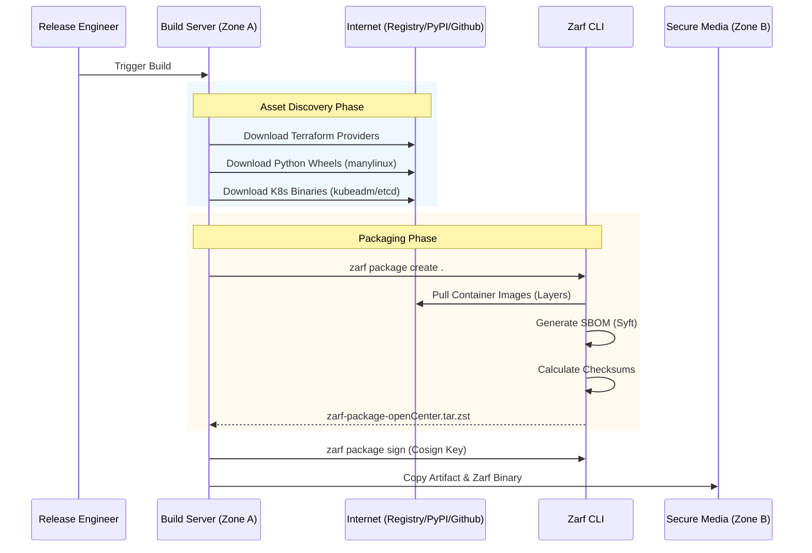
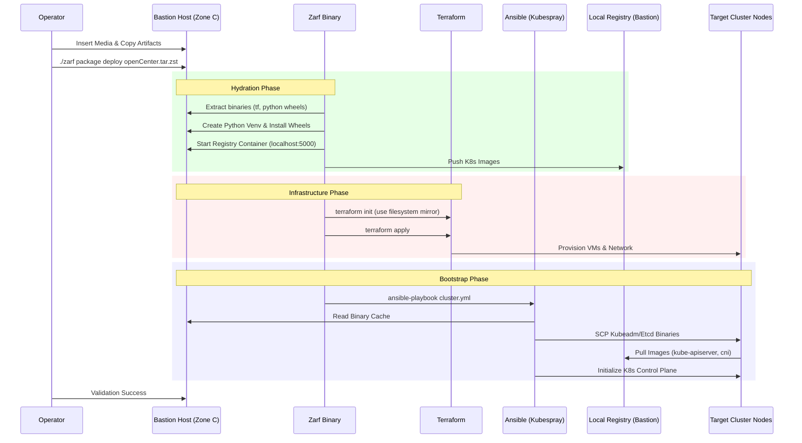

# openCenter AirGap: Consolidated Design Document
# Air-Gapped Kubernetes Deployment Architecture

| Field | Value |
|:---|:---|
| **Document Type** | Technical Design Document |
| **Version** | 1.0 |
| **Status** | Draft |
| **Date** | January 24, 2026 |

---

## 1. Executive Summary

openCenter-airgap is a comprehensive solution for deploying High Availability (HA) Kubernetes clusters in completely disconnected environments. The architecture encapsulates the entire provisioning toolchain—Kubespray for cluster bootstrapping, and FluxCD for GitOps—into a single, cryptographically verifiable Zarf artifact. Terraform is optionally included for OpenStack infrastructure provisioning.

The core innovation is the **"Disconnected-First"** design philosophy: internet isolation is treated as the baseline constraint, not an exception. This inverts the traditional "pull" model (lightweight installer fetches dependencies at runtime) to a "push" model (heavyweight artifact contains every requisite bit for the final state).

A single artifact, delivered via secure media to a bastion host, contains the intelligence to:
- **Primary Target:** Bootstrap Kubernetes on bare-metal or pre-provisioned hardware
- **Secondary Target:** Provision infrastructure (VMs, networks) on OpenStack via Terraform
- Hydrate a local registry with all container images
- Bootstrap a production-grade Kubernetes cluster
- Deploy core platform services via GitOps

All without a single byte of outbound network traffic.

---

## 2. Architectural Design Principles

### 2.1 The Three-Zone Model

The architecture separates concerns into three logical zones:

```
┌─────────────────────────────────────────────────────────────────────────────┐
│                        ZONE A: THE FACTORY                                  │
│                    (Connected Build Environment)                            │
│                                                                             │
│  Responsibilities:                                                          │
│  • Asset Discovery: Parse IaC/Ansible to identify dependency graph          │
│  • Pull Operations: Download images, packages, providers, wheels            │
│  • Package Creation: Bundle everything into Zarf artifact                   │
│  • SBOM Generation: Syft scans all content                                  │
│  • Integrity: Generate checksums, optionally sign with Cosign               │
└─────────────────────────────────────────────────────────────────────────────┘
                                    │
                                    ▼
┌─────────────────────────────────────────────────────────────────────────────┐
│                        ZONE B: THE AIRLOCK                                  │
│                        (Transport Layer)                                    │
│                                                                             │
│  The Transport Vehicle: openCenter-airgap-<version>.tar.zst                 │
│  • Immutable, read-only snapshot of dependency graph                        │
│  • Cryptographically signed (Cosign/Sigstore)                               │
│  • Data Diode compliant carrier                                             │
│  • Contains SBOM and checksum manifest                                      │
└─────────────────────────────────────────────────────────────────────────────┘
                                    │
                                    ▼
┌─────────────────────────────────────────────────────────────────────────────┐
│                        ZONE C: THE FIELD                                    │
│                   (Disconnected Run Environment)                            │
│                                                                             │
│  Bastion Host acts as "Pseudo-Internet":                                    │
│  • Executes Zarf binary and orchestrates deployment                         │
│  • Runs Terraform CLI with filesystem mirror                                │
│  • Serves as Ansible Control Node                                           │
│  • Hosts local Docker Registry (port 5000)                                  │
│  • Hosts local Apt/PyPI repository (Nginx, port 8080)                       │
│  • Cluster nodes pull all dependencies from bastion                         │
└─────────────────────────────────────────────────────────────────────────────┘
```

### 2.2 Toolchain Convergence Strategy

The architecture integrates four distinct technologies, each selected for a specific role:

| Tool | Role | Offline Strategy |
|:-----|:-----|:-----------------|
| **Zarf** | The Envelope | Packaging schema (`zarf.yaml`), runtime delivery, SBOM generation (Syft), cryptographic signing (Cosign/Sigstore). Replaces manual tar/scp workflows. |
| **Terraform** | The Provisioner (Optional) | Immutable infrastructure for OpenStack only. Uses Filesystem Mirror for providers—no Network Mirror protocol. Not required for bare-metal deployments. |
| **Kubespray** | The Bootstrapper | Industry-standard Ansible playbook. Inventory variables redirect all fetch requests to local sources. |
| **kubespray-offline** | The Map | Asset discovery logic ported into Zarf build pipeline. Runtime scripts superseded by Zarf component actions. |

### 2.3 Bastion Host Topology

The deployment assumes a "Bastion" or "Jumpbox" topology within the air-gapped network:

```
┌─────────────────────────────────────────────────────────────────────────────┐
│                           BASTION HOST                                      │
├─────────────────────────────────────────────────────────────────────────────┤
│  Role:                                                                      │
│  • Executes Zarf binary                                                     │
│  • Runs Terraform CLI                                                       │
│  • Serves as Ansible Control Node                                           │
│                                                                             │
│  Services:                                                                  │
│  • Container Registry (registry:2) on port 5000                             │
│  • Nginx serving apt/pip repos on port 8080                                 │
│                                                                             │
│  Requirements:                                                              │
│  • Linux OS (Ubuntu 24.04)                                                  │
│  • Container Runtime (Docker/Podman/containerd)                             │
│  • SSH access to target subnet                                              │
│  • ~100GB free disk space                                                   │
└─────────────────────────────────────────────────────────────────────────────┘
```

---

## 3. Artifact Model

The output is a single file: `zarf-package-openCenter-airgap-amd64-<version>.tar.zst`. This artifact is monolithically structured to ensure atomic delivery.

### 3.1 Package Components

| Component | Contents | Purpose |
|:----------|:---------|:--------|
| `bootstrap-tools` | Terraform binary (optional), Python wheels | Runtime dependencies for bastion |
| `terraform-providers` | Filesystem mirror structure, `.terraformrc` (optional) | Offline Terraform provider resolution for OpenStack |
| `kubespray-core` | Kubespray repo, inventory templates, K8s binaries | Cluster bootstrapping assets |
| `k8s-images` | Container images (registry:2, kube-*, calico, etc.) | All images for K8s and add-ons |
| `deploy-cluster` | Execution scripts | Orchestration of Terraform (optional) + Kubespray |

### 3.2 Zarf Package Schema (`zarf.yaml`)

```yaml
kind: ZarfPackageConfig
metadata:
  name: openCenter-airgap
  description: "Air-gapped Kubernetes Deployment Artifact"
  version: "1.0.0"
  architecture: amd64

variables:
  - name: DEPLOYMENT_MODE
    description: "Deployment mode (baremetal or openstack)"
    default: "baremetal"
  - name: TARGET_HOSTS
    description: "Comma separated list of target IPs (baremetal mode)"
  - name: SSH_USER
    description: "SSH User for Ansible"
    default: "deployer"
  - name: INSTALL_PATH
    description: "Path to extract assets on the Bastion"
    default: "/opt/opencenter"

components:
  - name: bootstrap-tools
    required: true
    files:
      - source: assets/bin/terraform  # Optional, OpenStack only
        target: /usr/local/bin/terraform
      - source: assets/python-wheels/
        target: ###ZARF_VAR_INSTALL_PATH###/wheels/
    actions:
      onDeploy:
        before:
          - cmd: "./scripts/setup-python-venv.sh"

  - name: terraform-providers
    required: false  # Only for OpenStack deployments
    files:
      - source: assets/terraform-mirror/
        target: ###ZARF_VAR_INSTALL_PATH###/terraform-mirror/
      - source: assets/terraform-config/.terraformrc
        target: /root/.terraformrc

  - name: kubespray-core
    required: true
    files:
      - source: kubespray/
        target: ###ZARF_VAR_INSTALL_PATH###/kubespray/
      - source: assets/k8s-binaries/
        target: ###ZARF_VAR_INSTALL_PATH###/k8s-binaries/
      - source: inventory-templates/
        target: ###ZARF_VAR_INSTALL_PATH###/inventory-templates/

  - name: k8s-images
    required: true
    images:
      - "registry:2"
      - "registry.k8s.io/kube-apiserver:v1.28.6"
      - "registry.k8s.io/kube-controller-manager:v1.28.6"
      - "registry.k8s.io/kube-scheduler:v1.28.6"
      - "registry.k8s.io/kube-proxy:v1.28.6"
      - "registry.k8s.io/pause:3.9"
      - "registry.k8s.io/etcd:3.5.9-0"
      - "registry.k8s.io/coredns/coredns:v1.10.1"
      - "docker.io/calico/cni:v3.26.1"
      - "docker.io/calico/node:v3.26.1"
      - "docker.io/calico/kube-controllers:v3.26.1"
    actions:
      onDeploy:
        before:
          - cmd: "docker run -d -p 5000:5000 --restart=always --name local-registry registry:2"
        after:
          - cmd: "./scripts/push-to-local-registry.sh"

  - name: deploy-cluster
    required: true
    actions:
      onDeploy:
        after:
          - cmd: "./scripts/run-terraform.sh"  # Conditional on DEPLOYMENT_MODE
            description: "Provision infrastructure (OpenStack only)"
          - cmd: "./scripts/run-kubespray.sh"
            description: "Bootstrap Kubernetes cluster"
```

### 3.3 Bastion-Registry Strategy

kubespray-offline provides the registry setup workflow:

1. **Transport**: Zarf carries kubespray-offline outputs (images as tar.gz, setup scripts)
2. **Container Runtime**: `setup-container.sh` installs containerd, loads nginx/registry images
3. **Web Server**: `start-nginx.sh` launches nginx:1.29.2 on port 80 (serves files/debs/pypi)
4. **Registry**: `start-registry.sh` launches registry:2.8.3 on port 35000
5. **Image Loading**: `load-push-all-images.sh` loads images from tar.gz and pushes to registry:35000
6. **Consume**: Kubespray configured with `registry_host: <Bastion-IP>:35000`

**Directory Structure on Bastion:**
```
/opt/opencenter/
├── files/          # K8s binaries (kubelet, kubectl, kubeadm, runc, containerd, etc.)
├── images/         # Container images as tar.gz
├── debs/           # Ubuntu package repository
├── pypi/           # PyPI mirror
├── playbook/       # offline-repo.yml for node configuration
└── scripts/        # setup-all.sh, start-nginx.sh, start-registry.sh, etc.
```

---

## 4. Asset Discovery & Dependency Resolution

The efficacy of air-gapped deployment is determined in Zone A (Factory). Missing a single checksum, wheel, or sub-dependency causes Field deployment failure.

### 4.1 Terraform Provider Discovery

```bash
#!/bin/bash
# collect_terraform_providers.sh
set -euo pipefail

MIRROR_DIR="assets/terraform-mirror"
mkdir -p ${MIRROR_DIR}

cat > build-requirements.tf <<EOF
terraform {
  required_providers {
    local     = { source = "hashicorp/local", version = "~> 2.4" }
    null      = { source = "hashicorp/null", version = "~> 3.2" }
    tls       = { source = "hashicorp/tls", version = "~> 4.0" }
    openstack = { source = "terraform-provider-openstack/openstack", version = "~> 1.54" }
    vsphere   = { source = "hashicorp/vsphere", version = "~> 2.6" }
  }
}
EOF

# Mirror for target platforms
terraform providers mirror \
    -platform=linux_amd64 \
    -platform=linux_arm64 \
    ${MIRROR_DIR}

# Generate cross-platform lock file (CRITICAL)
terraform providers lock \
    -platform=linux_amd64 \
    -platform=linux_arm64

mv .terraform.lock.hcl assets/terraform-config/
```

**Critical**: The `terraform providers lock -platform=` flag is mandatory. Without it, the lock file only contains hashes for the build machine OS. The offline Bastion will reject plugins with mismatched checksums.

**Note**: Using `~>` constraints allows patch updates while maintaining compatibility. Lock file pins exact versions downloaded.

### 4.2 Kubespray-Offline Integration

**kubespray-offline** provides the canonical asset discovery and download logic. Rather than reimplementing, we integrate its workflow into the Zarf build pipeline:

**Phase 1: Download Assets (Internet-Connected)**
```bash
#!/bin/bash
# Executed on build machine with internet access
git clone -b main https://github.com/kubespray-offline/kubespray-offline.git
cd kubespray-offline

# Configure versions in config.sh
export KUBESPRAY_VERSION=master  # Use master branch for latest
export RUNC_VERSION=1.3.4
export CONTAINERD_VERSION=2.1.5
export NERDCTL_VERSION=2.1.6
export CNI_VERSION=1.8.0
export NGINX_VERSION=1.29.2
export REGISTRY_VERSION=2.8.3
export REGISTRY_PORT=35000

# Download all offline artifacts
./download-all.sh

# Outputs directory structure:
# outputs/
#   files/          - K8s binaries (kubelet, kubectl, kubeadm, etc.)
#   images/         - Container images as tar.gz
#   rpms/ or debs/  - OS package repository
#   pypi/           - PyPI mirror
#   playbook/       - Ansible playbook for offline repo setup
```

**Phase 2: Package with Zarf**
```yaml
# zarf.yaml component integrating kubespray-offline outputs
components:
  - name: kubespray-offline-assets
    required: true
    files:
      - source: kubespray-offline/outputs/files/
        target: ###ZARF_VAR_INSTALL_PATH###/files/
      - source: kubespray-offline/outputs/images/
        target: ###ZARF_VAR_INSTALL_PATH###/images/
      - source: kubespray-offline/outputs/debs/
        target: ###ZARF_VAR_INSTALL_PATH###/debs/
      - source: kubespray-offline/outputs/pypi/
        target: ###ZARF_VAR_INSTALL_PATH###/pypi/
      - source: kubespray-offline/outputs/playbook/
        target: ###ZARF_VAR_INSTALL_PATH###/playbook/
      - source: kubespray-offline/target-scripts/
        target: ###ZARF_VAR_INSTALL_PATH###/scripts/
```

**Key kubespray-offline Scripts:**
- `download-all.sh`: Orchestrates complete download process
- `setup-all.sh`: Target node setup (registry, nginx, repos)
- `start-nginx.sh`: Launches nginx on port 80 serving files/debs/pypi
- `start-registry.sh`: Launches registry:2 on port 35000
- `load-push-all-images.sh`: Loads images and pushes to local registry
- `extract-kubespray.sh`: Extracts Kubespray tarball for deployment

### 4.3 Python Wheel Collection

```bash
#!/bin/bash
# collect_python_wheels.sh
set -e

KUBESPRAY_VERSION="v2.24.1"
TARGET_OS="manylinux2014_x86_64"

mkdir -p assets/python-wheels

curl -sL "https://raw.githubusercontent.com/kubernetes-sigs/kubespray/${KUBESPRAY_VERSION}/requirements.txt" \
    -o requirements.txt

pip3 download \
    --only-binary=:all: \
    --platform ${TARGET_OS} \
    --python-version 3.10 \
    --implementation cp \
    --abi cp310 \
    -r requirements.txt \
    -d assets/python-wheels/
```

---

## 5. Workflow Diagrams

### 5.1 Build Phase (Zone A → Zone B)



### 5.2 Deployment Phase (Zone C)



---

## 6. Implementation Details

### 6.1 Terraform Offline Configuration

The `.terraformrc` file redirects all provider requests to the local filesystem mirror:

```hcl
plugin_cache_dir   = "/opt/opencenter/terraform-cache"
disable_checkpoint = true

provider_installation {
  filesystem_mirror {
    path    = "/opt/opencenter/terraform-mirror"
    include = ["*/*"]
  }
}
```

### 6.2 Kubespray Offline Configuration (`offline.yml`)

Key inventory variables for air-gapped operation (based on kubespray-offline template):

| Variable | Value | Purpose |
|:---------|:------|:--------|
| `http_server` | `http://192.168.1.10` | Nginx server for files/debs/pypi |
| `registry_host` | `192.168.1.10:35000` | Local container registry |
| `files_repo` | `{{ http_server }}/files` | K8s binaries location |
| `yum_repo` | `{{ http_server }}/rpms` | RPM repository (RHEL) |
| `ubuntu_repo` | `{{ http_server }}/debs` | DEB repository (Ubuntu) |
| `kube_image_repo` | `{{ registry_host }}` | Points nodes to local registry |
| `gcr_image_repo` | `{{ registry_host }}` | Redirects GCR requests |
| `docker_image_repo` | `{{ registry_host }}` | Redirects Docker Hub requests |
| `quay_image_repo` | `{{ registry_host }}` | Redirects Quay requests |
| `github_image_repo` | `{{ registry_host }}` | Redirects GHCR requests |

**Containerd Insecure Registry Configuration:**
```yaml
containerd_registries_mirrors:
  - prefix: "{{ registry_host }}"
    mirrors:
      - host: "http://{{ registry_host }}"
        capabilities: ["pull", "resolve"]
        skip_verify: true
```

**Binary Download URLs:**
```yaml
kubeadm_download_url: "{{ files_repo }}/kubernetes/v{{ kube_version }}/kubeadm"
kubectl_download_url: "{{ files_repo }}/kubernetes/v{{ kube_version }}/kubectl"
kubelet_download_url: "{{ files_repo }}/kubernetes/v{{ kube_version }}/kubelet"
cni_download_url: "{{ files_repo }}/kubernetes/cni/cni-plugins-linux-{{ image_arch }}-v{{ cni_version }}.tgz"
crictl_download_url: "{{ files_repo }}/kubernetes/cri-tools/crictl-v{{ crictl_version }}-{{ ansible_system | lower }}-{{ image_arch }}.tar.gz"
runc_download_url: "{{ files_repo }}/runc/v{{ runc_version }}/runc.{{ image_arch }}"
containerd_download_url: "{{ files_repo }}/containerd-{{ containerd_version }}-linux-{{ image_arch }}.tar.gz"
nerdctl_download_url: "{{ files_repo }}/nerdctl-{{ nerdctl_version }}-{{ ansible_system | lower }}-{{ image_arch }}.tar.gz"
helm_download_url: "{{ files_repo }}/helm-v{{ helm_version }}-linux-{{ image_arch }}.tar.gz"
```

**Checksum Handling**: Kubespray validates SHA256 checksums against `roles/kubespray_defaults/vars/main/checksums.yml`. kubespray-offline downloads exact versions matching these checksums.

### 6.3 Zarf Component Actions

Zarf replaces manual shell scripts with idempotent component actions:

```yaml
actions:
  onDeploy:
    before:
      - cmd: "docker ps -q -f name=local-registry | grep . || docker run -d -p 5000:5000 -v /opt/registry:/var/lib/registry --name local-registry registry:2"
        description: "Ensure Registry is Running"
```

### 6.4 GitOps Core Services Deployment

After cluster bootstrap:

1. **FluxCD Installation**: Apply official install manifest, push images to local registry
2. **Gitea Deployment**: In-cluster Git server for GitOps source
3. **Repository Seeding**: Push manifests for cert-manager, ingress-nginx, Keycloak, kube-prometheus-stack
4. **Flux Configuration**: Create `GitRepository` and `Kustomization` CRs pointing to internal Gitea

---

## 7. Zarf vs. kubespray-offline Analysis

| Feature | kubespray-offline | OpenCenter (Zarf) | Integration Strategy |
|:--------|:------------------|:------------------|:---------------------|
| **Asset Discovery** | `download-all.sh` orchestrates downloads | N/A | Use kubespray-offline scripts in build phase |
| **Packaging** | Multiple tarballs in `outputs/` | Single `.tar.zst` artifact | Zarf packages kubespray-offline outputs |
| **Integrity** | Checksums for files, no SBOM | SBOM (Syft), Cosign/Sigstore signing | Zarf adds compliance layer |
| **Registry Setup** | `start-registry.sh` on port 35000 | Zarf component actions | Use kubespray-offline scripts via Zarf actions |
| **Web Server** | `start-nginx.sh` on port 80 | Zarf component actions | Use kubespray-offline scripts via Zarf actions |
| **Image Loading** | `load-push-all-images.sh` | Zarf component actions | Use kubespray-offline scripts via Zarf actions |
| **Node Config** | `offline-repo.yml` playbook | Zarf component actions | Use kubespray-offline playbook via Zarf |
| **Reproducibility** | Variable (operator execution) | Strict (immutable package) | Zarf orchestrates kubespray-offline scripts |

**Integration Model**:
- **Build Phase (Zone A)**: Execute kubespray-offline `download-all.sh` to populate `outputs/`
- **Package Phase (Zone A→B)**: Zarf bundles `outputs/` + target scripts into single artifact
- **Deploy Phase (Zone C)**: Zarf extracts and executes kubespray-offline setup scripts (`setup-all.sh`)
- **Bootstrap Phase (Zone C)**: Zarf runs Kubespray with offline.yml configuration

**Division of Labor**:
- **kubespray-offline**: Asset discovery, download logic, runtime setup scripts, offline.yml template
- **Zarf**: Atomic packaging, transport, SBOM/signing, orchestration, GitOps integration

---

## 8. Build Instructions

### 8.1 Prerequisites

- Ubuntu 24.04 build host with Docker/Podman
- 100GB+ free disk space
- Internet access for asset download
- Git, Python3, Terraform installed

### 8.2 Build Procedure

```bash
#!/bin/bash
# build_openCenter_airgap.sh
set -euo pipefail

# 1. Clone kubespray-offline@main
git clone -b main https://github.com/kubespray-offline/kubespray-offline.git
cd kubespray-offline

# 2. Configure versions (edit config.sh or export)
export KUBESPRAY_VERSION=master  # Use master branch
export RUNC_VERSION=1.3.4
export CONTAINERD_VERSION=2.1.5
export NERDCTL_VERSION=2.1.6
export CNI_VERSION=1.8.0
export NGINX_VERSION=1.29.2
export REGISTRY_VERSION=2.8.3
export REGISTRY_PORT=35000

# 3. Add core services images
cat >> imagelists/additional_images.txt <<EOF
quay.io/jetstack/cert-manager-controller:v1.13.0
quay.io/jetstack/cert-manager-webhook:v1.13.0
quay.io/jetstack/cert-manager-cainjector:v1.13.0
registry.k8s.io/ingress-nginx/controller:v1.9.0
quay.io/keycloak/keycloak:21.1.1
ghcr.io/fluxcd/source-controller:v1.4.1
ghcr.io/fluxcd/kustomize-controller:v1.4.0
ghcr.io/fluxcd/helm-controller:v1.1.0
ghcr.io/fluxcd/notification-controller:v1.4.0
gitea/gitea:1.21.0
EOF

# 4. Download all offline assets (downloads kubespray@master)
./download-all.sh

# 5. Collect Terraform providers (OpenStack optional)
cd ..
./scripts/collect_terraform_providers.sh

# 6. Build Zarf package
zarf package create --confirm --output-dir=./dist

# 7. Verify integrity
zarf package inspect dist/zarf-package-openCenter-airgap-amd64-*.tar.zst --sbom
```

---

## 9. Extending the Package

### 9.1 Adding New Services

1. **Images**: Add to `imagelists/additional_images.txt`, run `download-additional-containers.sh`
2. **Helm Charts**: Download to `outputs/charts/`
3. **Manifests**: Add to `outputs/gitops/`
4. **Rebuild**: Run `zarf package create`

### 9.2 Version Updates

- Update version variables in `config.sh`
- Re-run download scripts
- Rebuild package
- Verify SBOM includes new versions

---

## 10. Operational Runbooks

### 10.1 Pre-Deployment Checklist

- [ ] Zarf CLI installed on bastion (`zarf version`)
- [ ] Docker/containerd available
- [ ] SSH access to target nodes verified
- [ ] 100GB+ free disk on bastion
- [ ] **Bare-metal:** Node inventory prepared (IPs, hostnames)
- [ ] **OpenStack:** Cloud credentials ready
- [ ] Ports 5000, 8080 open on bastion firewall
- [ ] Package checksum verified

### 10.2 Deployment Steps

```bash
# 1. Transfer package to bastion
scp zarf-package-openCenter-airgap-*.tar.zst bastion:/opt/

# 2. On bastion: Deploy package
cd /opt
zarf package deploy zarf-package-openCenter-airgap-*.tar.zst --confirm

# Zarf will:
# - Extract kubespray-offline outputs to /opt/opencenter
# - Execute setup-all.sh (setup-container, start-nginx, start-registry, load-push-all-images)
# - Prompt for inventory (bare-metal) or OpenStack credentials
# - Run Terraform (if OpenStack mode)
# - Execute Kubespray with offline.yml configuration
# - Deploy FluxCD and core services

# 3. Verify cluster
export KUBECONFIG=/opt/opencenter/kubespray/inventory/mycluster/artifacts/admin.conf
kubectl get nodes
kubectl get pods -A

# 4. Verify local services
curl http://localhost/files/          # Nginx serving binaries
curl http://localhost:35000/v2/_catalog  # Registry catalog
```

### 10.3 Failure Modes & Recovery

| Issue | Symptom | Resolution |
|:------|:--------|:-----------|
| **Registry Not Running** | `start-registry.sh` fails | Check containerd installed: `./setup-container.sh` |
| **Nginx Not Serving** | 404 on http://bastion/files/ | Verify nginx container: `docker ps \| grep nginx` |
| **Image Pull BackOff** | Pods fail with `ErrImagePull` | Check registry: `curl http://bastion:35000/v2/_catalog` |
| **Checksum Mismatch** | Ansible fails at binary download | Verify kubespray-offline versions match Kubespray checksums.yml |
| **SSH Failure** | Ansible cannot reach nodes | Verify SSH keys, run `offline-repo.yml` playbook manually |
| **Terraform Lock Error** | `init` fails (missing hashes) | Rebuild with `terraform providers lock -platform=linux_amd64` |
| **Python Venv Failure** | Ansible install fails | Run `./setup-py.sh` manually, verify pip mirror at http://bastion/pypi/ |

### 10.4 Post-Deployment Verification

```bash
# Verify no external network calls
kubectl logs -n flux-system deployment/source-controller | grep -i error

# Check all pods running
kubectl get pods -A | grep -v Running | grep -v Completed

# Test internal DNS
kubectl run test --rm -it --image=busybox -- nslookup kubernetes

# Access Grafana
kubectl -n monitoring port-forward svc/grafana 3000:80
```

---

## 11. Security Considerations

### 11.1 Supply Chain Security

- **SBOM Generation**: Syft scans all content during `zarf package create`
- **Cryptographic Signing**: Cosign/Sigstore for package integrity
- **Checksum Verification**: MD5/SHA256 for all artifacts
- **Version Pinning**: No `latest` tags, all versions explicit

### 11.2 Credential Management

- Cloud credentials provided at runtime (not stored in package)
- Zarf variables support `sensitive: true` for secure prompts
- Gitea admin password should be rotated post-deployment

### 11.3 Network Isolation Verification

Post-deployment, verify no components attempt external connections:
- Monitor network traffic from cluster
- Check logs for external URL access errors
- Disable telemetry/analytics in Flux, Grafana, etc.
